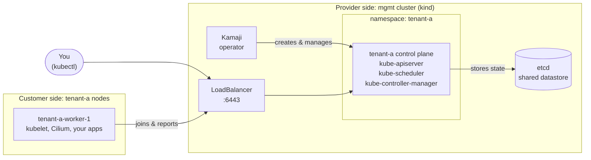
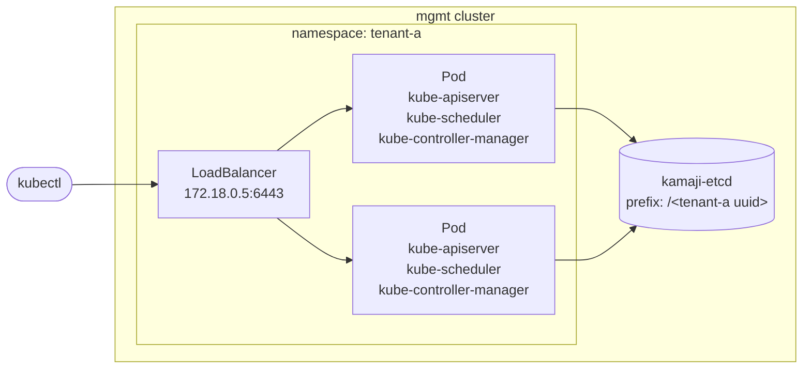
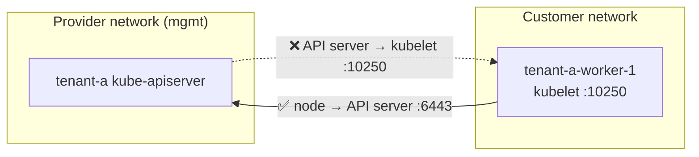
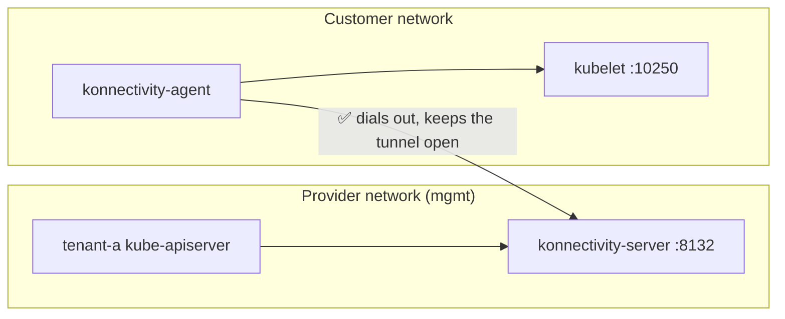

# Managed Kubernetes Workshop

**Build your own managed Kubernetes provider, on your laptop.**

When you click "Create Cluster" on a managed Kubernetes platform, like [LKS](https://www.latitude.sh/docs/lks), you get a working API server in a few minutes, but you never see the control plane. There are no control plane nodes to SSH into and no etcd to back up. You add worker nodes and they just join.

This workshop shows what's behind that button. You'll build the same pieces a provider might run, step by step, and hit the same problems they had to solve.

## What you'll build



There are two kinds of cluster here:

- **The management cluster (`mgmt`)**: run by the provider. Users never see it. It hosts the control planes of every customer cluster.
- **The tenant cluster (`tenant-a`)**: what the customer gets. Its control plane runs as ordinary Pods inside `mgmt`. Its worker nodes run elsewhere, in the "customer's" network.

You'll use one kubeconfig for each, so always check which cluster you're talking to.

## How this maps to the real world

| In this workshop | At a managed provider |
|---|---|
| `mgmt` kind cluster | The provider's internal fleet that runs customer control planes |
| Kamaji `TenantControlPlane` | The "cluster" you create in the console or API |
| `tenant-a-worker-*` Docker containers | Your node pools (VMs or bare metal) |
| `cloud-provider-kind` | The cloud load balancer in front of your API server |
| Konnectivity | The tunnel the control plane uses to reach your nodes |
| Sveltos `ClusterProfile` | The add-ons the provider installs in every cluster (CNI, CSI, metrics) |

## What we'll do

- [Create the management cluster](#3-create-the-kind-cluster-mgmt) and [install the platform](#5-install-helm-packages): cert-manager, Kamaji and etcd.
- [Create a hosted control plane](#6-create-your-first-hosted-control-plane-tenant-a) for `tenant-a` and look at what's inside it.
- [Join a worker node](#7-join-a-worker-node) and install a CNI.
- [Simulate a real provider network](#8-simulating-a-real-world-managed-kubernetes-network) and [watch `kubectl logs` and `kubectl exec` break](#9-lets-run-a-workload).
- [Fix them with Konnectivity](#10-fix-with-konnectivity).
- [Upgrade Kubernetes](#11-upgrade-kubernetes) the way providers do: control plane in place, workers by replacement.
- [Manage add-ons with Sveltos](#12-manage-add-ons-with-sveltos): install the CNI from the management cluster, the way providers do.
- [Bonus: run it on LKS](#14-bonus-run-it-on-lks), with real infrastructure.

## 1. Prerequisites

Install the following tools:

- [Docker](https://docs.docker.com/get-started/get-docker/): will be used to run every node in this workshop as a container, both the `mgmt` nodes and the tenant workers.
- [kubectl](https://kubernetes.io/docs/tasks/tools/): will be used to talk to both clusters, `mgmt` and `tenant-a`.
- [kind](https://kind.sigs.k8s.io/docs/user/quick-start/): will be used to create the `mgmt` cluster, with each node as a Docker container.
- [cloud-provider-kind](https://github.com/kubernetes-sigs/cloud-provider-kind): will be used to give `LoadBalancer` Services an IP, so the `tenant-a` API server gets an endpoint, like a cloud load balancer would.
- [Helm](https://helm.sh/docs/intro/install/): will be used to install cert-manager and Kamaji on `mgmt`.

Give Docker at least **4 CPUs, 8 GB of RAM and 20 GB of disk**. You'll run 5 Kubernetes nodes as containers: 3 for `mgmt` and 2 tenant workers.

> ⚠️ **Pause VPNs and security agents that inspect TLS** (Cloudflare WARP, Zscaler, Netskope and similar) for the duration of the workshop. They replace the certificates of the sites you visit with their own. Your machine trusts that certificate, but the Kubernetes nodes you'll run as containers don't, so they can't pull images. If you can't pause it, ask your IT team for help before the workshop.

## 2. Get the workshop files

Clone this repository and enter the folder. Every command in the workshop runs from here, because the manifests are referenced by relative path:
```
git clone https://github.com/latitudesh/managed-k8s-workshop.git
cd managed-k8s-workshop
```

## 3. Create the kind cluster (mgmt)

This is the provider's **management cluster**. Customers never see it, and it hosts their control planes. It has 1 control plane node and 2 workers, which gives the tenant control plane Pods and the etcd datastore room to spread out, like a small provider fleet.

Create the kind cluster:
```
kind create cluster --config manifests/kind-mgmt.yaml
kind get kubeconfig --name mgmt > mgmt.kubeconfig
```

> 💡 **Why a separate kubeconfig file?** You'll work with two clusters: `mgmt` (the provider) and `tenant-a` (the customer). Keeping one kubeconfig file and one alias for each makes it obvious which cluster you're talking to.

Create an alias to quickly manage the kind cluster:
```
alias kmgmt='kubectl --kubeconfig mgmt.kubeconfig'
```

Verify the kind cluster:
```
kmgmt get nodes
```

```
NAME                 STATUS   ROLES           AGE   VERSION
mgmt-control-plane   Ready    control-plane   30s   v1.36.4
mgmt-worker          Ready    <none>          20s   v1.36.4
mgmt-worker2         Ready    <none>          20s   v1.36.4
```

## 4. Start cloud-provider-kind

On a cloud, a `LoadBalancer` Service gets a real load balancer and an external IP. kind has no cloud, so these Services stay `<pending>` forever. `cloud-provider-kind` fills the gap: it watches for `LoadBalancer` Services and starts an Envoy container on the `kind` Docker network for each one, with its own IP.

This is how the `tenant-a` API server will get a reachable address like `172.18.0.5:6443`, just like a provider puts a load balancer in front of your control plane.

Start `cloud-provider-kind` in a separate terminal. Leave it running during the entire workshop.

On OSX:
```
sudo cloud-provider-kind
```

On Linux:
```
cloud-provider-kind
```

> 💡 **Why `sudo` on macOS?** On macOS, Docker runs inside a VM, so container IPs aren't reachable from your machine. `cloud-provider-kind` works around this with port mappings on the host, which needs extra privileges.

> ⚠️ **macOS firewall.** If macOS asks whether `cloud-provider-kind` can accept incoming network connections, click **Allow**. With the firewall on and the answer set to block, the load balancer addresses won't work from your machine. See [6.2 Connect to tenant-a](#62-connect-to-tenant-a) if that happens.

## 5. Install Helm packages

Next, install the platform the provider runs on the management cluster.

Add Helm repositories and update them:
```
helm repo add jetstack https://charts.jetstack.io
helm repo add cilium https://helm.cilium.io
helm repo add clastix https://clastix.github.io/charts
helm repo add projectsveltos https://projectsveltos.github.io/helm-charts

helm repo update
```

### 5.1 cert-manager

cert-manager issues and renews the platform's own certificates: TLS for Kamaji's admission webhooks, and the CA, server, peer and client certificates of the etcd datastore.

> 💡 The tenant control plane certificates (the CA, API server certs, kubeconfigs) are generated by Kamaji itself. You'll see them as Secrets when you create `tenant-a`.

Install cert-manager:
```
helm upgrade --install cert-manager jetstack/cert-manager \
  --kubeconfig mgmt.kubeconfig \
  --namespace cert-manager \
  --create-namespace \
  --version v1.21.2 \
  --set crds.enabled=true \
  --wait
```

<details>
<summary><code>Progress deadline exceeded</code> after 5 minutes?</summary>

Check the Pods with `kmgmt -n cert-manager get pods`. If they're in `ImagePullBackOff` and `kmgmt -n cert-manager get events` shows `x509: certificate signed by unknown authority`, a VPN or security agent on your machine is inspecting TLS. See [Prerequisites](#1-prerequisites). After pausing it, delete the Pods so they retry right away, then run the `helm` command again:
```
kmgmt -n cert-manager delete pod --all
```

</details>

### 5.2 Kamaji

Kamaji is the operator that turns the management cluster into a provider. It adds a `TenantControlPlane` resource: you declare a cluster (version, replicas, how to expose it), and Kamaji runs its control plane as a Deployment in `mgmt`.

The chart also installs a 3-replica etcd and registers it as the `default` **DataStore**. All tenant control planes can share it, each one under its own key prefix.

> 💡 **Why `0.0.0+latest`?** Since July 2024, Clastix no longer publishes versioned stable releases of Kamaji as open source. Stable artifacts are only available with a subscription. The open source project publishes monthly edge releases (for example, `26.3.2-edge`) and a `latest` chart. That's fine for a workshop. In production, pin an edge release instead. See [Kamaji versioning](https://kamaji.clastix.io/reference/versioning/).

Install Kamaji:
```
helm upgrade --install kamaji clastix/kamaji \
  --kubeconfig mgmt.kubeconfig \
  --namespace kamaji-system \
  --create-namespace \
  --version 0.0.0+latest \
  --wait
```

Verify Kamaji Pods:
```
kmgmt -n kamaji-system get pods
```

```
NAME                      READY   STATUS    RESTARTS   AGE
kamaji-667f5c4b7c-g6h5p   1/1     Running   0          116s
kamaji-etcd-0             1/1     Running   0          116s
kamaji-etcd-1             1/1     Running   0          84s
kamaji-etcd-2             1/1     Running   0          70s
```

You should see the Kamaji controller and 3 `kamaji-etcd` Pods, all `Running`.

Verify the Kamaji DataStores:
```
kmgmt get datastores
```

```
NAME      DRIVER   READY   AGE
default   etcd     true    2m6s
```

A **DataStore** is a cluster-scoped resource that tells Kamaji where tenant control planes keep their state: which driver, which endpoints, and which certificates to use. Here it's the 3-replica etcd, but Kamaji can also use PostgreSQL, MySQL or NATS. A provider can run several DataStores (per region, per tier) and choose one for each tenant with `spec.dataStore`. Our `tenant-a` uses `default`.

Take a closer look:
```
kmgmt describe datastore default
```

```
[...]
Spec:
  Driver:  etcd
  Endpoints:
    kamaji-etcd-0.kamaji-etcd.kamaji-system.svc.cluster.local:2379
    kamaji-etcd-1.kamaji-etcd.kamaji-system.svc.cluster.local:2379
    kamaji-etcd-2.kamaji-etcd.kamaji-system.svc.cluster.local:2379
[...]
Status:
  Ready:  true
```

## 6. Create your first hosted control plane (tenant-a)

This is the "Create Cluster" button. One `TenantControlPlane` resource becomes a full Kubernetes control plane, running as ordinary Pods in `mgmt`. No VMs to boot and no control plane nodes to manage.



Take a look at [`manifests/tenant-a.yaml`](manifests/tenant-a.yaml), each field is commented.

Create the `tenant-a` control plane:
```
kmgmt apply -f manifests/tenant-a.yaml
```

Watch it until it becomes `Ready`. This takes less than a minute:
```
kmgmt -n tenant-a get tenantcontrolplane tenant-a -w
```

```
NAME       VERSION   INSTALLED VERSION   STATUS   CONTROL-PLANE ENDPOINT   KUBECONFIG                  DATASTORE   AGE
tenant-a   v1.36.4   v1.36.4             Ready    172.18.0.5:6443          tenant-a-admin-kubeconfig   default     35s
```

- `CONTROL-PLANE ENDPOINT`: the IP `cloud-provider-kind` gave the `LoadBalancer` Service.
- `KUBECONFIG`: the Secret with the admin credentials.

### 6.1 What Kamaji created

```
kmgmt -n tenant-a get deploy,pods,svc,secrets
```

```
NAME                       READY   UP-TO-DATE   AVAILABLE   AGE
deployment.apps/tenant-a   2/2     2            2           36s

NAME                            READY   STATUS    RESTARTS   AGE
pod/tenant-a-548475996c-bztw9   3/3     Running   0          36s
pod/tenant-a-548475996c-ksbdd   3/3     Running   0          36s

NAME               TYPE           CLUSTER-IP      EXTERNAL-IP   PORT(S)          AGE
service/tenant-a   LoadBalancer   10.96.112.188   172.18.0.5    6443:31564/TCP   39s

NAME                                                    TYPE     DATA   AGE
secret/tenant-a-admin-kubeconfig                        Opaque   4      37s
secret/tenant-a-api-server-certificate                  Opaque   2      38s
secret/tenant-a-api-server-kubelet-client-certificate   Opaque   2      38s
secret/tenant-a-ca                                      Opaque   4      39s
secret/tenant-a-controller-manager-kubeconfig           Opaque   1      36s
secret/tenant-a-datastore-certificate                   Opaque   3      36s
secret/tenant-a-datastore-config                        Opaque   4      36s
secret/tenant-a-front-proxy-ca-certificate              Opaque   2      38s
secret/tenant-a-front-proxy-client-certificate          Opaque   2      38s
secret/tenant-a-sa-certificate                          Opaque   2      38s
secret/tenant-a-scheduler-kubeconfig                    Opaque   1      36s
```

- **A Deployment** with 2 replicas. The control plane gets everything a Deployment gives you: rolling updates, self-healing and scaling.
- **A Service** of type `LoadBalancer`, the cluster's public endpoint.
- **Secrets** with the cluster's PKI, the same files `kubeadm` writes to `/etc/kubernetes` on a regular control plane node: the CA, the API server certificates, the front proxy and service account keys, and a kubeconfig for each component. Kamaji generates them itself.
- **DataStore credentials**: `tenant-a-datastore-certificate` and `tenant-a-datastore-config`. Kamaji creates a dedicated etcd user for each tenant, limited to its own prefix.

The Pods run our known Kubernetes components as containers!
```
kmgmt -n tenant-a get pods -l kamaji.clastix.io/name=tenant-a \
  -o jsonpath='{range .items[0].spec.containers[*]}{.name}{"\n"}{end}'
```

```
kube-apiserver
kube-scheduler
kube-controller-manager
```

> 💡 **Where's etcd?** Not in the Pod. State lives in the shared DataStore, so the control plane Pods are stateless. You can delete, reschedule or upgrade them without losing the cluster.

> 💡 **Bring your own etcd.** The DataStore doesn't have to be the etcd that ships with Kamaji. You can run your own etcd cluster with other tools (like etcd-operator) and register it as a DataStore. As long as the API server can reach it, everything works.

Where does the `kube-apiserver` listen?
```
kmgmt -n tenant-a get deploy tenant-a -o yaml | grep -E -- '--advertise-address'
```

```
        - --advertise-address=172.18.0.5
```

It advertises the load balancer IP, not the Pod IP. That's the address nodes and clients will use.

And the `etcd` configuration?
```
kmgmt -n tenant-a get deploy tenant-a -o yaml | grep -E -- '--etcd'
```

```
        - --etcd-cafile=/etc/kubernetes/pki/etcd/ca.crt
        - --etcd-certfile=/etc/kubernetes/pki/etcd/server.crt
        - --etcd-compaction-interval=0
        - --etcd-keyfile=/etc/kubernetes/pki/etcd/server.key
        - --etcd-prefix=/7dd222a4-1aec-4f64-b9bc-bacaec821ae3
        - --etcd-servers=https://kamaji-etcd-0.kamaji-etcd.kamaji-system.svc.cluster.local:2379,https://kamaji-etcd-1.kamaji-etcd.kamaji-system.svc.cluster.local:2379,https://kamaji-etcd-2.kamaji-etcd.kamaji-system.svc.cluster.local:2379
```

- `--etcd-servers`: the shared etcd, from the `default` DataStore.
- `--etcd-prefix`: every key `tenant-a` writes lives under its own UUID. That's how one etcd serves many clusters.

### 6.2 Connect to tenant-a

Get the `tenant-a`'s kubeconfig:
```
kmgmt -n tenant-a get secret tenant-a-admin-kubeconfig -o jsonpath='{.data.admin\.conf}' | base64 -d > tenant-a.kubeconfig
```

> 💡 The Secret holds more than one kubeconfig:
> - `admin.conf`: points to the load balancer (`https://172.18.0.5:6443`), for clients outside `mgmt`.
> - `admin.svc`: points to the in-cluster Service (`https://tenant-a.tenant-a.svc:6443`), for tools running inside `mgmt`.

Create a little alias to make our life easier:
```
alias kta='kubectl --kubeconfig tenant-a.kubeconfig'
```

Verify our newly created Kubernetes cluster:
```
kta version
```

```
Client Version: v1.36.2
Kustomize Version: v5.8.1
Server Version: v1.36.4
```

<details>
<summary><code>connection reset by peer</code> on <code>172.18.0.5:6443</code>? (macOS)</summary>

On macOS, `cloud-provider-kind` gives your machine the load balancer IP as an alias on the loopback interface, and runs a small tunnel on `172.18.0.5:6443` that forwards to the Envoy container. The macOS firewall treats that tunnel as an incoming connection to `cloud-provider-kind`. If the firewall is on and the app is set to block, the TCP connection opens and is reset right away, with nothing in the `cloud-provider-kind` logs.

Check the rule. The path is the one your install uses; this is what it looks like with Homebrew on Apple silicon:
```
/usr/libexec/ApplicationFirewall/socketfilterfw --listapps | grep -A1 cloud-provider-kind
```

```
/opt/homebrew/Cellar/cloud-provider-kind/0.12.0/bin/cloud-provider-kind
             (Block incoming connections)
```

Allow it in System Settings, under Network, Firewall, Options, switching `cloud-provider-kind` to **Allow incoming connections**, or from the terminal. `realpath` follows the Homebrew symlink to the binary the firewall registered:
```
sudo /usr/libexec/ApplicationFirewall/socketfilterfw --unblockapp "$(realpath "$(command -v cloud-provider-kind)")"
```

On a company-managed Mac, both can be locked by a profile. In that case, skip the tunnel: only `kubectl` on your machine goes through it, the containers reach the load balancer directly on the `kind` network. Point the alias at the port Docker mapped for the Envoy container. The port changes whenever `cloud-provider-kind` recreates the container, so look it up on every call:
```
alias kta='kubectl --kubeconfig tenant-a.kubeconfig --server https://127.0.0.1:$(docker port $(docker ps -q --filter name=kindccm) 6443/tcp | head -1 | cut -d: -f2)'
```

The API server certificate includes `127.0.0.1`, so TLS verification still works. Everything else in the workshop stays the same, including `TENANT_A_APISERVER_IP`, which the worker node uses from inside the Docker network.

</details>

It looks like any other cluster, but something is missing:
```
kta get nodes
```

```
No resources found
```

No nodes at all. The control plane runs in `mgmt`, so it never shows up as a node. This is exactly what you see on a managed provider before you add a node pool.

```
kta get pods -A
```

```
NAMESPACE     NAME                       READY   STATUS    RESTARTS   AGE
kube-system   coredns-695c5d47b8-ds6rf   0/1     Pending   0          8s
kube-system   coredns-695c5d47b8-gvq7h   0/1     Pending   0          9s
```

CoreDNS (the addon Kamaji installed) is `Pending`: there's nowhere to schedule it. You'll fix that by joining a worker node.

```
kta get ns
```

```
NAME              STATUS   AGE
default           Active   19s
kube-node-lease   Active   19s
kube-public       Active   20s
kube-system       Active   20s
```

### 6.3 Export helpful variables

Save the API server IP. You'll need it to join nodes and to configure Cilium:
```
export TENANT_A_APISERVER_IP=$(kmgmt -n tenant-a get svc tenant-a -o jsonpath='{.status.loadBalancer.ingress[0].ip}')
```

## 7. Join a worker node

On a managed provider, adding a node pool means booting machines in your network that join the hosted control plane. Here, a worker node is a Docker container running the `kindest/node` image, the same image kind uses for its own nodes. It comes with containerd, kubelet and kubeadm preinstalled.

Create the worker node as a Docker container:
```
docker run -d --name tenant-a-worker-1 --hostname tenant-a-worker-1 --network kind --privileged --volume /var kindest/node:v1.36.4
```

- `--network kind`: the same Docker network as kind, so the node can reach the API server.
- `--privileged`: kubelet and containerd need full access to the "machine" to run containers.
- `--volume /var`: containerd needs a real filesystem for its images, not the container's overlay filesystem.

Verify it is up and running:
```
docker ps | grep tenant-a-worker-1
```

```
7e47d010be76   kindest/node:v1.36.4            "/usr/local/bin/entr…"   9 seconds ago   Up 5 seconds      tenant-a-worker-1
```

Exec into the container and verify it can reach the `tenant-a` `kube-apiserver`:
```
docker exec -ti tenant-a-worker-1 curl -k "https://$TENANT_A_APISERVER_IP:6443"
```

```
{
  "kind": "Status",
  "apiVersion": "v1",
  "metadata": {},
  "status": "Failure",
  "message": "forbidden: User \"system:anonymous\" cannot get path \"/\"",
  "reason": "Forbidden",
  "details": {},
  "code": 403
}
```

A `403` is good news: the network path works and TLS works. The API server just doesn't know who we are yet.

### 7.1 Bootstrap the node

Copy the control plane's kubeconfig into the worker node:
```
docker cp tenant-a.kubeconfig tenant-a-worker-1:/root/tenant.kubeconfig
```

```
Successfully copied 5.63kB (transferred 7.17kB) to tenant-a-worker-1:/root/tenant.kubeconfig
```

> 💡 **Shortcut alert.** We only need the admin kubeconfig to create a join token. A real provider creates the token on its side and hands it to the machine at boot (for example, through cloud-init). The node never sees admin credentials.

Generate the kubeadm join command:
```
JOIN=$(docker exec tenant-a-worker-1 kubeadm token create --print-join-command --kubeconfig /root/tenant.kubeconfig)
echo $JOIN
```

```
kubeadm join 172.18.0.5:6443 --token <redacted> --discovery-token-ca-cert-hash sha256:1f4d615c0a70093910299f4469f0f7e47ab45c9daa15aeb68acf5570dcfae28c
```

- `172.18.0.5:6443`: the API server, through the load balancer.
- `--token`: a short-lived bootstrap token. It only allows the node to ask for its own credentials.
- `--discovery-token-ca-cert-hash`: the hash of the cluster CA. The node uses it to check it's talking to the right control plane.

Run the kubeadm join command:
```
docker exec tenant-a-worker-1 sh -c "$JOIN --ignore-preflight-errors=all"
```

```
[...]
[kubelet-start] Waiting for the kubelet to perform the TLS Bootstrap

This node has joined the cluster:
* Certificate signing request was sent to apiserver and a response was received.
* The Kubelet was informed of the new secure connection details.

Run 'kubectl get nodes' on the control-plane to see this node join the cluster.
```

Verify the worker node has joined!
```
kta get node
```

```
NAME                STATUS     ROLES    AGE   VERSION
tenant-a-worker-1   NotReady   <none>   24s   v1.36.4
```

It joined, but it's `NotReady`. Ask the node why:
```
kta get node tenant-a-worker-1 -o jsonpath='{.status.conditions[?(@.type=="Ready")].message}'
```

```
container runtime network not ready: NetworkReady=false reason:NetworkPluginNotReady message:Network plugin returns error: cni plugin not initialized
```

Pods are still not running, we need a CNI:
```
kta get pod -A
```

```
NAMESPACE     NAME                       READY   STATUS    RESTARTS   AGE
kube-system   coredns-695c5d47b8-ndv5c   0/1     Pending   0          12m
kube-system   coredns-695c5d47b8-twmks   0/1     Pending   0          12m
```

### 7.2 Install a CNI

The CNI runs on the worker nodes, on the customer's side of the cluster. We use Cilium, which also replaces kube-proxy (that's why `kubeProxy` is disabled in `tenant-a.yaml`).

Install Cilium CNI:
```
helm upgrade --install cilium cilium/cilium --version 1.20.2 \
  --kubeconfig tenant-a.kubeconfig \
  --namespace kube-system \
  --set kubeProxyReplacement=true \
  --set k8sServiceHost=$TENANT_A_APISERVER_IP \
  --set k8sServicePort=6443 \
  --set ipam.mode=kubernetes \
  --set operator.replicas=1
```

- `kubeProxyReplacement=true`: Cilium handles Services with eBPF, so we don't need kube-proxy.
- `k8sServiceHost` and `k8sServicePort`: without kube-proxy, nothing routes the `kubernetes` Service yet, so Cilium talks to the API server load balancer directly.
- `ipam.mode=kubernetes`: use the Pod CIDR the controller-manager assigns to each node (`10.244.0.0/24` here).
- `operator.replicas=1`: we only have one node.

<details>
<summary>Using the firewall workaround from 6.2? Helm needs it too</summary>

`helm` reads the kubeconfig directly and ignores the `kta` alias, so it hits the blocked tunnel. Point it at the Docker port with `--kube-apiserver`. The API server certificate includes `127.0.0.1`, so TLS verification still works:
```
TENANT_A_LOCAL_PORT=$(docker port $(docker ps -q --filter name=kindccm) 6443/tcp | head -1 | cut -d: -f2)

helm upgrade --install cilium cilium/cilium --version 1.20.2 \
  --kubeconfig tenant-a.kubeconfig \
  --kube-apiserver https://127.0.0.1:$TENANT_A_LOCAL_PORT \
  --namespace kube-system \
  --set kubeProxyReplacement=true \
  --set k8sServiceHost=$TENANT_A_APISERVER_IP \
  --set k8sServicePort=6443 \
  --set ipam.mode=kubernetes \
  --set operator.replicas=1
```

`k8sServiceHost` stays `172.18.0.5`: that address is used by the Cilium agent on the worker node, inside the Docker network.

</details>

Verify the worker node gets `Ready`:
```
kta get nodes -w
```

```
NAME                STATUS   ROLES    AGE    VERSION
tenant-a-worker-1   Ready    <none>   111s   v1.36.4
```

Verify the Pods are all `Ready`:
```
kta get pods -A
```

```
NAMESPACE     NAME                               READY   STATUS    RESTARTS   AGE
kube-system   cilium-envoy-tjn5n                 1/1     Running   0          2m28s
kube-system   cilium-htbgw                       1/1     Running   0          2m28s
kube-system   cilium-operator-6647c45686-mspfd   1/1     Running   0          2m27s
kube-system   coredns-695c5d47b8-ndv5c           1/1     Running   0          20m
kube-system   coredns-695c5d47b8-twmks           1/1     Running   0          20m
```

- `cilium-*`: the Cilium agent, one per node. It sets up Pod networking and Services.
- `cilium-envoy-*`: the Envoy proxy Cilium uses for L7 features, one per node.
- `cilium-operator-*`: cluster-wide housekeeping for Cilium.
- `coredns-*`: finally `Running`, now that the node has a network.

## 8. Simulating a real world managed Kubernetes network

So far everything lives on the same Docker network, so the control plane can reach the worker node directly. That's not how a managed provider works. The control plane runs in the provider's network, and your nodes run in yours. Nodes can reach the API server through its public endpoint, but the API server can't open connections into your network.



Most of Kubernetes only needs the node → API server direction. A few features need the other one, because the API server has to call the kubelet:

- `kubectl logs`
- `kubectl exec` and `kubectl attach`
- `kubectl port-forward`

Simulate the boundary: block the `mgmt` nodes from reaching the kubelet port (`10250`) on the worker node.
```
for n in $(kind get nodes --name mgmt); do
  ip=$(docker inspect -f '{{range .NetworkSettings.Networks}}{{.IPAddress}}{{end}}' "$n")
  docker exec tenant-a-worker-1 iptables -I INPUT -p tcp --dport 10250 -s "$ip" -j DROP
done

docker exec tenant-a-worker-1 iptables -L INPUT -n | grep 10250
```

```
DROP       tcp  --  172.18.0.2           0.0.0.0/0            tcp dpt:10250
DROP       tcp  --  172.18.0.4           0.0.0.0/0            tcp dpt:10250
DROP       tcp  --  172.18.0.3           0.0.0.0/0            tcp dpt:10250
```

- `kind get nodes --name mgmt`: lists the 3 `mgmt` nodes, where the `tenant-a` API server Pods run.
- `docker inspect`: gets each node's IP on the `kind` network.
- `iptables ... -j DROP`: silently drops TCP traffic from that IP to port `10250`.

> 💡 **Why block the `mgmt` node IPs, not the API server Pods?** Traffic leaving a Pod for an address outside the cluster is translated to its node's IP. From the worker's point of view, the API server calls come from the `mgmt` nodes.

## 9. Let's run a workload

Create a Deployment:
```
kta create deployment web --image=nginx:1.29 --replicas=2
```

```
deployment.apps/web created
```

Expose it with a NodePort Service:
```
kta create service nodeport web --tcp=80:80 --node-port=30080
```

```
service/web created
```

Call it from the worker node:
```
docker exec tenant-a-worker-1 curl http://localhost:30080 --retry 10 --retry-all-errors --retry-delay 2
```

```
[...]
<p><em>Thank you for using nginx.</em></p>
[...]
```

The workload works: the scheduler placed the Pods, the kubelet started them, and Cilium routes the Service. All of it only needs the node → API server direction.

Logs fail :(
```
kta logs deploy/web -f --request-timeout 5s
```

```
Found 2 pods, using pod/web-795767664d-sl6tx
Get "https://172.18.0.5:6443/api/v1/namespaces/default/pods/web-795767664d-sl6tx/log?container=nginx&follow=true&timeout=5s": context deadline exceeded
Unable to connect to the server: context deadline exceeded
```

- `context deadline exceeded`: `kubectl` reached the API server, but the API server never got an answer from the kubelet.

Exec too (it takes about a minute to fail):
```
kta exec deploy/web -- hostname
```

```
error: unable to upgrade connection: error dialing backend: dial tcp 172.18.0.6:10250: i/o timeout
```

- `dial tcp 172.18.0.6:10250`: the API server tried to open a connection to the kubelet on the worker node.
- `i/o timeout`: our iptables rule dropped it.

## 10. Fix with Konnectivity

The API server can't reach into the customer network, but the nodes can reach out. So turn the connection around: something on the node dials **out** to the control plane and keeps a tunnel open, and the API server sends its kubelet traffic back through it. That's [Konnectivity](https://kubernetes.io/docs/tasks/extend-kubernetes/setup-konnectivity/), the Kubernetes project for exactly this problem.



- `konnectivity-server`: a new container in the control plane Pods.
- `konnectivity-agent`: runs on the worker nodes and dials out to the server.

Patch the `TenantControlPlane` resource to enable Konnectivity:
```
kmgmt -n tenant-a patch tcp tenant-a --type merge -p '{"spec":{"addons":{"konnectivity":{"server":{"port":8132},"agent":{"mode":"DaemonSet"}}}}}'
```

```
tenantcontrolplane.kamaji.clastix.io/tenant-a patched
```

- `server.port: 8132`: the port the `konnectivity-server` listens on.
- `agent.mode: DaemonSet`: run one agent on every worker node.

The `tenant-a` control plane Pods roll. Thanks to the Deployment, the API server stays available during the change:
```
kmgmt -n tenant-a get pods
```

```
NAME                        READY   STATUS    RESTARTS   AGE
tenant-a-9787c789c-thdlw    4/4     Running   0          35s
tenant-a-9787c789c-x8wvh    4/4     Running   0          35s
```

They now carry a 4th container:
```
kmgmt -n tenant-a get deploy tenant-a -o jsonpath='{range .spec.template.spec.containers[*]}{.name}{"\n"}{end}'
```

```
kube-apiserver
kube-scheduler
kube-controller-manager
konnectivity-server
```

The Service now also exposes port 8132:
```
kmgmt -n tenant-a get svc tenant-a
```

```
NAME       TYPE           CLUSTER-IP      EXTERNAL-IP   PORT(S)                         AGE
tenant-a   LoadBalancer   10.96.112.188   172.18.0.5    6443:31564/TCP,8132:31247/TCP   4d14h
```

- `6443`: the API server, as before.
- `8132`: the `konnectivity-server`, where the agents connect.

Kamaji installed the agent inside `tenant-a`. Wait until the tunnel is up:
```
kta -n kube-system rollout status ds/konnectivity-agent
```

```
daemon set "konnectivity-agent" successfully rolled out
```

Check where the agent connects to:
```
kta -n kube-system get ds konnectivity-agent -o yaml | grep -E -- '--proxy-server'
```

```
        - --proxy-server-host=172.18.0.5
        - --proxy-server-port=8132
```

- `--proxy-server-host`: the load balancer, the same public endpoint the kubelet uses.
- `--proxy-server-port`: the `konnectivity-server` port.

The iptables rules are still there. We didn't open anything; the traffic just flows the other way. Try the logs again:
```
kta logs deploy/web --tail 5
```

```
Found 2 pods, using pod/web-795767664d-sl6tx
2026/10/27 13:34:06 [notice] 1#1: start worker process 38
2026/10/27 13:34:06 [notice] 1#1: start worker process 39
[...]
```

And exec:
```
kta exec deploy/web -- hostname
```

```
web-795767664d-sl6tx
```

## 11. Upgrade Kubernetes

Managed providers upgrade a cluster in two steps: the control plane first, then the worker nodes. The order matters. Kubernetes allows the kubelet to be older than the API server, but never newer (see the [version skew policy](https://kubernetes.io/releases/version-skew-policy/)).

### 11.1 Upgrade the control plane

In a second terminal, keep an eye on the `tenant-a` control plane Pods:
```
kmgmt -n tenant-a get pods -w
```

```
NAME                       READY   STATUS    RESTARTS   AGE
tenant-a-9787c789c-thdlw   4/4     Running   0          6m28s
tenant-a-9787c789c-x8wvh   4/4     Running   0          6m28s
```

Patch the `TenantControlPlane` with a new Kubernetes version:
```
kmgmt -n tenant-a patch tenantcontrolplane tenant-a --type merge -p '{"spec":{"kubernetes":{"version":"v1.37.0"}}}'
```

```
tenantcontrolplane.kamaji.clastix.io/tenant-a patched
```

Verify the `TenantControlPlane` resource status (`Upgrading` -> `Ready`):
```
kmgmt -n tenant-a get tenantcontrolplane tenant-a -w
```

```
NAME       VERSION   INSTALLED VERSION   STATUS      CONTROL-PLANE ENDPOINT   KUBECONFIG                  DATASTORE   AGE
tenant-a   v1.37.0   v1.36.4             Upgrading   172.18.0.5:6443          tenant-a-admin-kubeconfig   default     4d14h
[...]
tenant-a   v1.37.0   v1.37.0             Ready       172.18.0.5:6443          tenant-a-admin-kubeconfig   default     4d14h
```

- `VERSION`: the version you asked for.
- `INSTALLED VERSION`: the version actually running. It catches up when the upgrade is done.

Meanwhile, in the second terminal, the Deployment rolls the control plane Pods:
```
NAME                        READY   STATUS              RESTARTS   AGE
tenant-a-6c94fb5755-2fp22   0/4     ContainerCreating   0          0s
tenant-a-6c94fb5755-rqgnv   0/4     ContainerCreating   0          0s
[...]
tenant-a-6c94fb5755-2fp22   4/4     Running             0          31s
tenant-a-6c94fb5755-rqgnv   4/4     Running             0          31s
tenant-a-9787c789c-x8wvh    4/4     Terminating         0          7m2s
tenant-a-9787c789c-thdlw    4/4     Terminating         0          7m2s
```

- `tenant-a-6c94fb5755-*`: the new Pods, running `v1.37.0`.
- `tenant-a-9787c789c-*`: the old Pods keep serving until the new ones are ready, then terminate.

Verify, from `tenant-a`'s perspective, the new Kubernetes version:
```
kta version
```

```
Client Version: v1.36.2
Kustomize Version: v5.8.1
Server Version: v1.37.0
```

And the worker node is still v1.36.4:
```
kta get node
```

```
NAME                STATUS   ROLES    AGE   VERSION
tenant-a-worker-1   Ready    <none>   66m   v1.36.4
```

Our workload didn't notice anything:
```
kta get pods
```

```
NAME                   READY   STATUS    RESTARTS   AGE
web-795767664d-c4xkh   1/1     Running   0          15m
web-795767664d-sl6tx   1/1     Running   0          15m
```

### 11.2 Upgrade the worker node

Managed providers usually don't upgrade nodes in place. They add a new node with the new version, move the workloads, and remove the old one. Every node starts from a clean image, and if something goes wrong, the old node is still there.

Add a new worker node with v1.37.0, the same way you joined the first one:
```
docker run -d --name tenant-a-worker-2 --hostname tenant-a-worker-2 --network kind --privileged --volume /var kindest/node:v1.37.0

docker cp tenant-a.kubeconfig tenant-a-worker-2:/root/tenant.kubeconfig

JOIN=$(docker exec tenant-a-worker-2 kubeadm token create --print-join-command --kubeconfig /root/tenant.kubeconfig)

docker exec tenant-a-worker-2 sh -c "$JOIN --ignore-preflight-errors=all"
```

Verify the new worker node arrived in the cluster:
```
kta get node -w
```

```
NAME                STATUS   ROLES    AGE   VERSION
tenant-a-worker-1   Ready    <none>   4d    v1.36.4
tenant-a-worker-2   Ready    <none>   31s   v1.37.0
```

Cilium and the Konnectivity agent are DaemonSets, so they start on the new node automatically:
```
kta -n kube-system rollout status ds/cilium
kta -n kube-system rollout status ds/konnectivity-agent
```

```
daemon set "cilium" successfully rolled out
daemon set "konnectivity-agent" successfully rolled out
```

Drain the old worker node:
```
kta drain tenant-a-worker-1 --ignore-daemonsets --delete-emptydir-data --force
```

```
node/tenant-a-worker-1 cordoned
Warning: ignoring DaemonSet-managed Pods: kube-system/cilium-envoy-7vvsl, kube-system/cilium-q8cz2, kube-system/konnectivity-agent-lpfcj
evicting pod default/web-795767664d-sl6tx
evicting pod default/web-795767664d-c4xkh
[...]
node/tenant-a-worker-1 drained
```

- `drain`: cordons the node, so no new Pods get scheduled on it, then evicts its Pods. They get recreated on `tenant-a-worker-2`.
- `--ignore-daemonsets`: DaemonSet Pods (Cilium, Konnectivity agent) belong to their node, so skip them instead of failing.
- `--delete-emptydir-data`: allow evicting Pods with `emptyDir` volumes. That data is lost.
- `--force`: also evict Pods not managed by a controller. They won't be recreated.

Remove the old worker node:
```
kta delete node tenant-a-worker-1

docker rm -f tenant-a-worker-1
```

Verify everything runs on the new worker node:
```
kta get pods -A -o wide
```

```
NAMESPACE     NAME                               READY   STATUS    RESTARTS   AGE    IP             NODE                NOMINATED NODE   READINESS GATES
default       web-795767664d-fs2jd               1/1     Running   0          63s    10.244.1.127   tenant-a-worker-2   <none>           <none>
default       web-795767664d-jzfb4               1/1     Running   0          63s    10.244.1.239   tenant-a-worker-2   <none>           <none>
kube-system   cilium-envoy-6kt8g                 1/1     Running   0          105s   172.18.0.7     tenant-a-worker-2   <none>           <none>
kube-system   cilium-operator-6647c45686-jgzzt   1/1     Running   0          63s    172.18.0.7     tenant-a-worker-2   <none>           <none>
kube-system   cilium-qdz2z                       1/1     Running   0          105s   172.18.0.7     tenant-a-worker-2   <none>           <none>
kube-system   coredns-695c5d47b8-9dglb           1/1     Running   0          63s    10.244.1.48    tenant-a-worker-2   <none>           <none>
kube-system   coredns-695c5d47b8-wx79f           1/1     Running   0          63s    10.244.1.80    tenant-a-worker-2   <none>           <none>
kube-system   konnectivity-agent-kq2wr           1/1     Running   0          69s    10.244.1.117   tenant-a-worker-2   <none>           <none>
```

The cluster is fully on `v1.37.0`, and the workload kept running the whole time.

## 12. Manage add-ons with Sveltos

So far you installed Cilium by hand: `helm install` from your laptop, with the admin kubeconfig, against one cluster. A provider runs hundreds of clusters and installs the same add-ons in all of them: the CNI, a CSI driver, metrics-server. Nobody runs `helm install` for each one. The management cluster has to do it.

[Project Sveltos](https://projectsveltos.io/) is a Kubernetes add-on controller for exactly this. It runs in `mgmt`, holds a kubeconfig for each tenant cluster, and installs Helm charts and manifests into every cluster that matches a label selector. You describe the add-ons once, and Sveltos pushes them to all matching clusters.

### 12.1 Install Sveltos

Install Sveltos in the management cluster:
```
helm upgrade --install projectsveltos projectsveltos/projectsveltos \
  --kubeconfig mgmt.kubeconfig \
  --namespace projectsveltos \
  --create-namespace \
  --version 1.17.0 \
  --set agent.managementCluster=true \
  --wait
```

- `agent.managementCluster=true`: Sveltos runs a small agent per managed cluster, to classify it and run health checks. By default it deploys the agent inside each managed cluster. This flag keeps the agents in `mgmt`, so nothing of the provider's runs in the customer's cluster.

Verify the Sveltos Pods:
```
kmgmt -n projectsveltos get pods
```

```
NAME                                                  READY   STATUS    RESTARTS   AGE
access-manager-78fd55564-xh7zz                        1/1     Running   0          74s
addon-controller-66f6794688-2f89d                     1/1     Running   0          74s
classifier-manager-85694b7d48-c9rfz                   1/1     Running   0          73s
event-manager-74686dc998-knwqb                        1/1     Running   0          73s
hc-manager-66f5c47879-hr58l                           1/1     Running   0          74s
mcp-server-6947bf5467-njp76                           1/1     Running   0          73s
sc-manager-f657d9bc9-kcqxn                            1/1     Running   0          74s
shard-controller-8c5d75cf6-jvhb8                      1/1     Running   0          74s
sveltos-agent-80blpcdud783g9s9ugwi-77776c6975-bl56n   1/1     Running   0          42s
techsupport-controller-65b78994df-dx8vm               1/1     Running   0          73s
```

- `addon-controller`: the one we care about. It reads `ClusterProfile`s and runs Helm against the tenant clusters.
- `sc-manager`: watches `SveltosCluster`s and checks it can reach their API server.
- `classifier-manager` and `sveltos-agent-*`: classify managed clusters (for example, by Kubernetes version). One agent per cluster, kept in `mgmt` by the flag above.
- `access-manager`, `event-manager`, `hc-manager`, `shard-controller`, `techsupport-controller`, `mcp-server`: features we don't use in this workshop.

Sveltos also registered the management cluster itself:
```
kmgmt get sveltoscluster -A
```

```
NAMESPACE   NAME   READY   VERSION   AGE   SHARD
mgmt        mgmt   true    v1.36.4   43s
```

- `mgmt`: a `SveltosCluster` for the management cluster, so you can manage add-ons in `mgmt` the same way. We'll leave it alone.

### 12.2 Register tenant-a

Sveltos needs to know `tenant-a` exists and how to reach it. That's a `SveltosCluster` resource pointing to a Secret with a kubeconfig. Kamaji already created that Secret: `tenant-a-admin-kubeconfig`, and its `admin.svc` key points to the in-cluster Service, exactly what a tool running inside `mgmt` needs.

Take a look at [`manifests/sveltos-tenant-a.yaml`](manifests/sveltos-tenant-a.yaml), each field is commented.

Register `tenant-a`:
```
kmgmt apply -f manifests/sveltos-tenant-a.yaml
```

```
sveltoscluster.lib.projectsveltos.io/tenant-a created
```

Verify Sveltos can reach it:
```
kmgmt get sveltoscluster -A
```

```
NAMESPACE   NAME       READY   VERSION   AGE   SHARD
mgmt        mgmt       true    v1.36.4   63s
tenant-a    tenant-a   true    v1.37.0   20s
```

- `READY`: Sveltos connected to the `tenant-a` API server with the kubeconfig from the Secret.
- `VERSION`: the Kubernetes version it found there.

> 💡 **Shortcut alert.** The admin kubeconfig makes Sveltos cluster-admin in `tenant-a`. A provider would give its add-on manager its own identity, with only the permissions it needs.

Nothing landed in `tenant-a`:
```
kta get ns
```

```
NAME              STATUS   AGE
cilium-secrets    Active   3m19s
default           Active   12d
kube-node-lease   Active   12d
kube-public       Active   12d
kube-system       Active   12d
```

- No `projectsveltos` namespace: Sveltos only talks to the API server, like you do with `kubectl`.
- `cilium-secrets`: Cilium's own namespace, from the manual install.

### 12.3 Uninstall Cilium by hand

Cilium is still the one you installed by hand. Remove it, so Sveltos can own it:
```
helm uninstall cilium --kubeconfig tenant-a.kubeconfig --namespace kube-system
```

```
release "cilium" uninstalled
```

The Cilium Pods are gone:
```
kta get pods -A
```

```
NAMESPACE     NAME                       READY   STATUS    RESTARTS   AGE
default       web-795767664d-lq6bc       1/1     Running   0          7d22h
default       web-795767664d-sz58f       1/1     Running   0          7d22h
kube-system   coredns-695c5d47b8-cd99k   1/1     Running   0          7d22h
kube-system   coredns-695c5d47b8-mp8g6   1/1     Running   0          7d22h
kube-system   konnectivity-agent-kq2wr   1/1     Running   0          7d23h
```

- The other Pods keep running: their network was wired up when they started, and the kernel keeps it. New Pods would not start.

But the node still says `Ready`:
```
kta get nodes
```

```
NAME                STATUS   ROLES    AGE     VERSION
tenant-a-worker-2   Ready    <none>   7d23h   v1.37.0
```

Helm removed Cilium's Pods, but not the CNI config file the Cilium agent wrote on the node. containerd reads that file and tells the kubelet the network is ready. Remove it, to put the node back where it was before [Install a CNI](#72-install-a-cni):
```
docker exec tenant-a-worker-2 rm /etc/cni/net.d/05-cilium.conflist
```

The node goes `NotReady`, for the same reason as before:
```
kta get nodes -w
```

```
NAME                STATUS     ROLES    AGE     VERSION
tenant-a-worker-2   NotReady   <none>   7d23h   v1.37.0
```

```
kta get node tenant-a-worker-2 -o jsonpath='{.status.conditions[?(@.type=="Ready")].message}'
```

```
container runtime network not ready: NetworkReady=false reason:NetworkPluginNotReady message:Network plugin returns error: cni plugin not initialized
```

### 12.4 Install Cilium with Sveltos

A `ClusterProfile` says which clusters (a label selector) get what (Helm charts, manifests). Take a look at [`manifests/sveltos-cilium.yaml`](manifests/sveltos-cilium.yaml): it's the same chart, version and values as the manual install, each field commented.

The only value that changes from one cluster to another is the API server IP. Replace the placeholder with yours and apply:
```
sed "s/TENANT_A_APISERVER_IP/$TENANT_A_APISERVER_IP/" manifests/sveltos-cilium.yaml | kmgmt apply -f -
```

```
clusterprofile.config.projectsveltos.io/cilium created
```

Sveltos matched the profile to `tenant-a` through the `cni: cilium` label:
```
kmgmt get clusterprofile cilium -o jsonpath='{.status.matchingClusters[*].name}'
```

```
tenant-a
```

For each matching cluster, Sveltos creates a `ClusterSummary`: the state of that profile on that cluster. Watch it:
```
kmgmt -n tenant-a get clustersummary -o wide -w
```

```
NAME                      AGE   HELMCHARTS     KUSTOMIZEREFS   POLICYREFS
cilium-sveltos-tenant-a   6s    Provisioning
cilium-sveltos-tenant-a   10s   Provisioned
```

- `HELMCHARTS`: `Provisioning` while Sveltos runs the Helm install in `tenant-a`, then `Provisioned`.

Back in `tenant-a`, the node is `Ready` again:
```
kta get nodes
```

```
NAME                STATUS   ROLES    AGE     VERSION
tenant-a-worker-2   Ready    <none>   7d23h   v1.37.0
```

And the Cilium Pods are back:
```
kta -n kube-system get pods
```

```
NAME                               READY   STATUS    RESTARTS   AGE
cilium-bxtft                       1/1     Running   0          44s
cilium-envoy-wk6st                 1/1     Running   0          44s
cilium-operator-7bcf667cdb-mbp6l   1/1     Running   0          44s
coredns-695c5d47b8-cd99k           1/1     Running   0          7d22h
coredns-695c5d47b8-mp8g6           1/1     Running   0          7d22h
konnectivity-agent-kq2wr           1/1     Running   0          7d23h
```

It's still Helm. Sveltos ran the same install, from `mgmt`, with the kubeconfig Kamaji generated:
```
helm list --kubeconfig tenant-a.kubeconfig -A
```

```
NAME  	NAMESPACE  	REVISION	UPDATED                               	STATUS  	CHART        	APP VERSION
cilium	kube-system	1       	2026-11-04 13:08:34.48236522 +0000 UTC	deployed	cilium-1.20.2	1.20.2
```

> 💡 **This is how the CNI is already there when you create a cluster.**

## 13. Clean up

Delete the kind cluster. This removes the management cluster, and with it the `tenant-a` control plane and its state in etcd:
```
kind delete cluster --name mgmt
```

Delete the worker node containers. They aren't part of the kind cluster, so `kind` doesn't know about them:
```
docker rm -fv tenant-a-worker-1 tenant-a-worker-2 2>/dev/null
```

Stop `cloud-provider-kind` with `Ctrl+C` in its terminal.

Delete the kubeconfig files:
```
rm -f mgmt.kubeconfig tenant-a.kubeconfig
```

## 14. Bonus: run it on LKS

kind is great to learn, but everything runs on your laptop. Now let's do it with real infrastructure: an [LKS](https://www.latitude.sh/docs/lks) cluster as the management cluster, and a bare metal server as the worker node.

What's different from the kind setup:

- **Management cluster**: an LKS cluster with 3 worker nodes, instead of kind.
- **Load balancer**: LKS gives `LoadBalancer` Services a public Elastic IP, so there's no `cloud-provider-kind`.
- **Worker node**: an Ubuntu 24.04 bare metal server, instead of a Docker container.
- **Network**: the `tenant-a` API server is on the public internet, like on a real managed provider.

You need:

- An LKS cluster with 3 worker nodes.
- A Latitude.sh bare metal server running Ubuntu 24.04, that you can SSH into.
- `kubectl` and `helm` on your machine.

### 14.1 Management cluster on LKS

Grab the kubeconfig of your LKS cluster from the Latitude.sh dashboard and point the `kmgmt` alias to it. That way, every `kmgmt` command from the workshop works as is:
```
alias kmgmt='kubectl --kubeconfig /path/to/lks-cluster-kubeconfig.yaml'

kmgmt get nodes
```

Kamaji's etcd needs persistent volumes. Check that the cluster has a default StorageClass:
```
kmgmt get storageclass
```

- `latitude-block (default)`: the 3 `kamaji-etcd` replicas get their volumes from it.

Install cert-manager and Kamaji exactly as in [Install Helm packages](#5-install-helm-packages), replacing `--kubeconfig mgmt.kubeconfig` with the path to your LKS kubeconfig. Then verify the DataStore:
```
kmgmt get datastores
```

### 14.2 Hosted control plane on LKS

The only change to `tenant-a` is the load balancer class. Take a look at [`manifests/tenant-a-lks.yaml`](manifests/tenant-a-lks.yaml):

- `networkProfile.loadBalancerClass: latitude.sh/elastic-ip`: LKS only gives an Elastic IP to `LoadBalancer` Services with this class. Without it, the Service stays `<pending>`.

Create the `tenant-a` control plane:
```
kmgmt apply -f manifests/tenant-a-lks.yaml
```

Watch it until it becomes `Ready`:
```
kmgmt -n tenant-a get tenantcontrolplane tenant-a -w
```

- `CONTROL-PLANE ENDPOINT`: now a public Elastic IP.

Get the kubeconfig and save the API server IP, as before:
```
kmgmt -n tenant-a get secret tenant-a-admin-kubeconfig -o jsonpath='{.data.admin\.conf}' | base64 -d > tenant-a.kubeconfig

alias kta='kubectl --kubeconfig tenant-a.kubeconfig'

export TENANT_A_APISERVER_IP=$(kmgmt -n tenant-a get svc tenant-a -o jsonpath='{.status.loadBalancer.ingress[0].ip}')

kta version
```

### 14.3 Prepare the worker node

Save the server's public IP:
```
export WORKER_IP=<your server IP>
```

SSH into the server and become root:
```
ssh ubuntu@$WORKER_IP

sudo -i
```

The remaining steps in this section run on the server.

Disable swap:
```
swapoff -a
sed -i '/ swap / s/^/#/' /etc/fstab
```

Load the kernel modules and set the sysctls Kubernetes networking needs:
```
cat <<EOF > /etc/modules-load.d/k8s.conf
overlay
br_netfilter
EOF

modprobe overlay
modprobe br_netfilter

cat <<EOF > /etc/sysctl.d/k8s.conf
net.ipv4.ip_forward = 1
net.bridge.bridge-nf-call-iptables = 1
net.bridge.bridge-nf-call-ip6tables = 1
EOF

sysctl --system
```

- `overlay`: the filesystem containerd uses for container images.
- `br_netfilter` and `bridge-nf-call-*`: let iptables see bridged Pod traffic.
- `ip_forward`: let the node route Pod traffic.

Install containerd and runc:
```
CONTAINERD_VERSION=2.4.2
RUNC_VERSION=1.5.2

curl -fsSL https://github.com/containerd/containerd/releases/download/v${CONTAINERD_VERSION}/containerd-${CONTAINERD_VERSION}-linux-amd64.tar.gz | tar -xz -C /usr/local
curl -fsSL -o /etc/systemd/system/containerd.service https://raw.githubusercontent.com/containerd/containerd/main/containerd.service
curl -fsSL -o /usr/local/sbin/runc https://github.com/opencontainers/runc/releases/download/v${RUNC_VERSION}/runc.amd64
chmod +x /usr/local/sbin/runc

mkdir -p /etc/containerd
containerd config default | sed 's/SystemdCgroup = false/SystemdCgroup = true/' > /etc/containerd/config.toml

systemctl daemon-reload
systemctl enable --now containerd
```

Verify containerd uses `systemd` cgroups, matching the `cgroupfs: systemd` kubelet setting in `tenant-a-lks.yaml`:
```
grep SystemdCgroup /etc/containerd/config.toml
```

```
            SystemdCgroup = true
```

Install kubelet and kubeadm, the same version as the control plane:
```
apt-get update
apt-get install -y apt-transport-https ca-certificates curl gpg

mkdir -p /etc/apt/keyrings
curl -fsSL https://pkgs.k8s.io/core:/stable:/v1.36/deb/Release.key | gpg --dearmor -o /etc/apt/keyrings/kubernetes-apt-keyring.gpg
echo 'deb [signed-by=/etc/apt/keyrings/kubernetes-apt-keyring.gpg] https://pkgs.k8s.io/core:/stable:/v1.36/deb/ /' > /etc/apt/sources.list.d/kubernetes.list

apt-get update
apt-get install -y kubelet=1.36.4-1.1 kubeadm=1.36.4-1.1
apt-mark hold kubelet kubeadm
```

- `apt-mark hold`: stop `apt upgrade` from upgrading Kubernetes behind your back.

Verify the server can reach the `tenant-a` API server. Replace the IP with your `TENANT_A_APISERVER_IP`:
```
curl -k https://<TENANT_A_APISERVER_IP>:6443
```

- `403 Forbidden`: good news, as before. The network path and TLS work.

### 14.4 Join the worker node

From your machine, copy the `tenant-a` kubeconfig to the server:
```
scp tenant-a.kubeconfig ubuntu@$WORKER_IP:/tmp/tenant.kubeconfig
```

On the server, as root, create the join command, run it, and delete the kubeconfig:
```
JOIN=$(kubeadm token create --print-join-command --kubeconfig /tmp/tenant.kubeconfig)
$JOIN

rm /tmp/tenant.kubeconfig
```

Back on your machine, the node joins as `NotReady`, as before:
```
kta get nodes
```

Install Cilium exactly as in [Install a CNI](#72-install-a-cni), then wait for the node to become `Ready`:
```
kta get nodes -w
```

### 14.5 Next steps

Your hosted control plane now runs on LKS with a bare metal worker node. Now go on your own adventure! You might want to:

- [Run a workload](#9-lets-run-a-workload) and call its NodePort over SSH.
- Block the LKS nodes from reaching the kubelet port, like in [Simulating a real world managed Kubernetes network](#8-simulating-a-real-world-managed-kubernetes-network), and watch `logs` and `exec` break.
- [Enable Konnectivity](#10-fix-with-konnectivity) to fix them.
- [Upgrade the control plane](#111-upgrade-the-control-plane) to `v1.37.0`.
- [Install Sveltos](#12-manage-add-ons-with-sveltos) in the LKS cluster and let it install Cilium on the bare metal node.
- Create a `tenant-b` and run two hosted control planes on the same LKS cluster.

### 14.6 Clean up LKS

Delete `tenant-a`. This deletes its Service and releases the Elastic IP:
```
kmgmt delete -f manifests/tenant-a-lks.yaml
```

Reset the worker node:
```
ssh ubuntu@$WORKER_IP sudo kubeadm reset -f
```

Delete the LKS cluster and the server from the Latitude.sh dashboard if you don't need them anymore.
