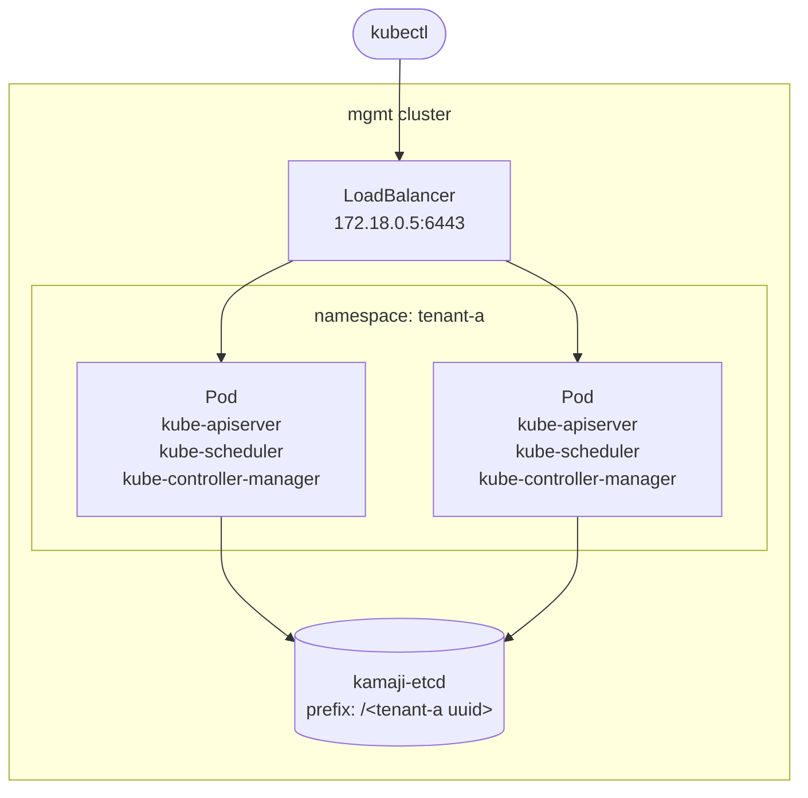

# 6. Create a hosted control plane (tenant-a)

This is the "Create Cluster" button. One `TenantControlPlane` resource becomes a full Kubernetes control plane, running as ordinary Pods in `mgmt`. No VMs to boot and no control plane nodes to manage.

<div class="lat-diagram" markdown>



</div>

Take a look at [`manifests/tenant-a.yaml`](https://github.com/latitudesh/managed-k8s-workshop/blob/main/manifests/tenant-a.yaml), each field is commented.

Create the `tenant-a` control plane:
```sh
kmgmt apply -f manifests/tenant-a.yaml
```

Watch it until it becomes `Ready`:
```sh
kmgmt -n tenant-a get tenantcontrolplane tenant-a -w
```

```{ .text .no-copy title="Output" }
NAME       VERSION   INSTALLED VERSION   STATUS   CONTROL-PLANE ENDPOINT   KUBECONFIG                  DATASTORE   AGE
tenant-a   v1.36.4   v1.36.4             Ready    172.18.0.5:6443          tenant-a-admin-kubeconfig   default     35s
```

- `CONTROL-PLANE ENDPOINT`: the IP `cloud-provider-kind` gave the `LoadBalancer` Service.
- `KUBECONFIG`: the Secret with the admin credentials.

## 6.1 What Kamaji created

```sh
kmgmt -n tenant-a get deploy,pods,svc,secrets
```

```{ .text .no-copy title="Output" }
NAME                       READY   UP-TO-DATE   AVAILABLE   AGE
deployment.apps/tenant-a   2/2     2            2           36s

NAME                            READY   STATUS    RESTARTS   AGE
pod/tenant-a-548475996c-bztw9   3/3     Running   0          36s
pod/tenant-a-548475996c-ksbdd   3/3     Running   0          36s

NAME               TYPE           CLUSTER-IP      EXTERNAL-IP   PORT(S)          AGE
service/tenant-a   LoadBalancer   10.96.112.188   172.18.0.5    6443:31564/TCP   39s

NAME                                                    TYPE     DATA   AGE
secret/tenant-a-admin-kubeconfig                        Opaque   4      37s
secret/tenant-a-api-server-certificate                  Opaque   2      38s
secret/tenant-a-api-server-kubelet-client-certificate   Opaque   2      38s
secret/tenant-a-ca                                      Opaque   4      39s
secret/tenant-a-controller-manager-kubeconfig           Opaque   1      36s
secret/tenant-a-datastore-certificate                   Opaque   3      36s
secret/tenant-a-datastore-config                        Opaque   4      36s
secret/tenant-a-front-proxy-ca-certificate              Opaque   2      38s
secret/tenant-a-front-proxy-client-certificate          Opaque   2      38s
secret/tenant-a-sa-certificate                          Opaque   2      38s
secret/tenant-a-scheduler-kubeconfig                    Opaque   1      36s
```

- **A Deployment** with 2 replicas. The control plane gets everything a Deployment gives you: rolling updates, self-healing and scaling.
- **A Service** of type `LoadBalancer`, the cluster's public endpoint.
- **Secrets** with the cluster's PKI, the same files `kubeadm` writes to `/etc/kubernetes` on a regular control plane node: the CA, the API server certificates, the front proxy and service account keys, and a kubeconfig for each component. Kamaji generates them itself.
- **DataStore credentials**: `tenant-a-datastore-certificate` and `tenant-a-datastore-config`. Kamaji creates a dedicated etcd user for each tenant, limited to its own prefix.

The Pods run our known Kubernetes components as containers!
```sh
kmgmt -n tenant-a get pods -l kamaji.clastix.io/name=tenant-a \
  -o jsonpath='{range .items[0].spec.containers[*]}{.name}{"\n"}{end}'
```

```{ .text .no-copy title="Output" }
kube-apiserver
kube-scheduler
kube-controller-manager
```

!!! tip "Where's etcd?"
    Not in the Pod. State lives in the shared DataStore, so the control plane Pods are stateless. You can delete, reschedule or upgrade them without losing the cluster.

!!! tip "Bring your own etcd"
    The DataStore doesn't have to be the etcd that ships with Kamaji. You can run your own etcd cluster with other tools (like etcd-operator) and register it as a DataStore. As long as the API server can reach it, everything works.

Where does the `kube-apiserver` listen?
```sh
kmgmt -n tenant-a get deploy tenant-a -o yaml \
  | grep -E -- '--advertise-address'
```

```{ .text .no-copy title="Output" }
        - --advertise-address=172.18.0.5
```

It advertises the load balancer IP, not the Pod IP. That's the address nodes and clients will use.

And the `etcd` configuration?
```sh
kmgmt -n tenant-a get deploy tenant-a -o yaml | grep -E -- '--etcd'
```

```{ .text .no-copy title="Output" }
        - --etcd-cafile=/etc/kubernetes/pki/etcd/ca.crt
        - --etcd-certfile=/etc/kubernetes/pki/etcd/server.crt
        - --etcd-compaction-interval=0
        - --etcd-keyfile=/etc/kubernetes/pki/etcd/server.key
        - --etcd-prefix=/7dd222a4-1aec-4f64-b9bc-bacaec821ae3
        - --etcd-servers=https://kamaji-etcd-0.kamaji-etcd.kamaji-system.svc.cluster.local:2379,https://kamaji-etcd-1.kamaji-etcd.kamaji-system.svc.cluster.local:2379,https://kamaji-etcd-2.kamaji-etcd.kamaji-system.svc.cluster.local:2379
```

- `--etcd-servers`: the shared etcd, from the `default` DataStore.
- `--etcd-prefix`: every key `tenant-a` writes lives under its own UUID. That's how one etcd serves many clusters.

## 6.2 Connect to tenant-a

Get the `tenant-a`'s kubeconfig:
```sh
kmgmt -n tenant-a get secret tenant-a-admin-kubeconfig \
  -o jsonpath='{.data.admin\.conf}' | base64 -d > tenant-a.kubeconfig
```

!!! tip
    The Secret holds more than one kubeconfig:

    - `admin.conf`: points to the load balancer (`https://172.18.0.5:6443`), for clients outside `mgmt`.
    - `admin.svc`: points to the in-cluster Service (`https://tenant-a.tenant-a.svc:6443`), for tools running inside `mgmt`.

Create a little alias to make our life easier:
```sh
alias kta='kubectl --kubeconfig tenant-a.kubeconfig'
```

Verify our newly created Kubernetes cluster:
```sh
kta version
```

```{ .text .no-copy title="Output" }
Client Version: v1.36.2
Kustomize Version: v5.8.1
Server Version: v1.36.4
```

!!! troubleshooting "`connection reset by peer` on `172.18.0.5:6443`? (macOS)"
    See [Troubleshooting: macOS firewall](troubleshooting.md#macos-firewall).

It looks like any other cluster, but something is missing:
```sh
kta get nodes
```

```{ .text .no-copy title="Output" }
No resources found
```

No nodes at all. The control plane runs in `mgmt`, so it never shows up as a node. This is exactly what you see on a managed provider before you add a node pool.

```sh
kta get pods -A
```

```{ .text .no-copy title="Output" }
NAMESPACE     NAME                       READY   STATUS    RESTARTS   AGE
kube-system   coredns-695c5d47b8-ds6rf   0/1     Pending   0          8s
kube-system   coredns-695c5d47b8-gvq7h   0/1     Pending   0          9s
```

CoreDNS (the addon Kamaji installed) is `Pending`: there's nowhere to schedule it. You'll fix that by joining a worker node.

```sh
kta get ns
```

```{ .text .no-copy title="Output" }
NAME              STATUS   AGE
default           Active   19s
kube-node-lease   Active   19s
kube-public       Active   20s
kube-system       Active   20s
```

## 6.3 Export helpful variables

Save the API server IP. You'll need it to join nodes and to configure Cilium:
```sh
export TENANT_A_APISERVER_IP=$(kmgmt -n tenant-a get svc tenant-a \
  -o jsonpath='{.status.loadBalancer.ingress[0].ip}')
```

--8<-- "vevox-checkpoint.md"

You have a control plane with no nodes. Next, [join a worker node](07-worker-node.md).
