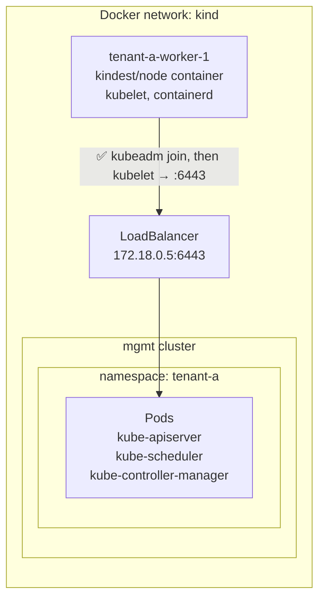

# 7. Join a worker node

On a managed provider, adding a node pool means booting machines in your network that join the hosted control plane. Here, a worker node is a Docker container running the `kindest/node` image, the same image kind uses for its own nodes. It comes with containerd, kubelet and kubeadm preinstalled.



Create the worker node as a Docker container:
```sh
docker run -d --name tenant-a-worker-1 --hostname tenant-a-worker-1 \
  --network kind --privileged --volume /var kindest/node:v1.36.4
```

- `--network kind`: the same Docker network as kind, so the node can reach the API server.
- `--privileged`: kubelet and containerd need full access to the "machine" to run containers.
- `--volume /var`: containerd needs a real filesystem for its images, not the container's overlay filesystem.

Verify it is up and running:
```sh
docker ps | grep tenant-a-worker-1
```

```{ .text .no-copy title="Output" }
7e47d010be76   kindest/node:v1.36.4            "/usr/local/bin/entr…"   9 seconds ago   Up 5 seconds      tenant-a-worker-1
```

Exec into the container and verify it can reach the `tenant-a` `kube-apiserver`:
```sh
docker exec -ti tenant-a-worker-1 \
  curl -k "https://$TENANT_A_APISERVER_IP:6443"
```

```{ .text .no-copy title="Output" }
{
  "kind": "Status",
  "apiVersion": "v1",
  "metadata": {},
  "status": "Failure",
  "message": "forbidden: User \"system:anonymous\" cannot get path \"/\"",
  "reason": "Forbidden",
  "details": {},
  "code": 403
}
```

A `403` is good news: the network path works and TLS works. The API server just doesn't know who we are yet.

## 7.1 Bootstrap the node

Copy the control plane's kubeconfig into the worker node:
```sh
docker cp tenant-a.kubeconfig tenant-a-worker-1:/root/tenant.kubeconfig
```

```{ .text .no-copy title="Output" }
Successfully copied 5.63kB (transferred 7.17kB) to tenant-a-worker-1:/root/tenant.kubeconfig
```

!!! tip "Shortcut alert"
    We only need the admin kubeconfig to create a join token. A real provider creates the token on its side and hands it to the machine at boot (for example, through cloud-init). The node never sees admin credentials.

Generate the kubeadm join command:
```sh
JOIN=$(docker exec tenant-a-worker-1 kubeadm token create \
  --print-join-command --kubeconfig /root/tenant.kubeconfig)
echo $JOIN
```

```{ .text .no-copy title="Output" }
kubeadm join 172.18.0.5:6443 --token <redacted> --discovery-token-ca-cert-hash sha256:1f4d615c0a70093910299f4469f0f7e47ab45c9daa15aeb68acf5570dcfae28c
```

- `172.18.0.5:6443`: the API server, through the load balancer.
- `--token`: a short-lived bootstrap token. It only allows the node to ask for its own credentials.
- `--discovery-token-ca-cert-hash`: the hash of the cluster CA. The node uses it to check it's talking to the right control plane.

Run the kubeadm join command:
```sh
docker exec tenant-a-worker-1 sh -c "$JOIN --ignore-preflight-errors=all"
```

```{ .text .no-copy title="Output" }
[...]
[kubelet-start] Waiting for the kubelet to perform the TLS Bootstrap

This node has joined the cluster:
* Certificate signing request was sent to apiserver and a response was received.
* The Kubelet was informed of the new secure connection details.

Run 'kubectl get nodes' on the control-plane to see this node join the cluster.
```

Verify the worker node has joined!
```sh
kta get node
```

```{ .text .no-copy title="Output" }
NAME                STATUS     ROLES    AGE   VERSION
tenant-a-worker-1   NotReady   <none>   24s   v1.36.4
```

It joined, but it's `NotReady`. Ask the node why:
```sh
kta get node tenant-a-worker-1 \
  -o jsonpath='{.status.conditions[?(@.type=="Ready")].message}'
```

```{ .text .no-copy title="Output" }
container runtime network not ready: NetworkReady=false reason:NetworkPluginNotReady message:Network plugin returns error: cni plugin not initialized
```

Pods are still not running, we need a CNI:
```sh
kta get pod -A
```

```{ .text .no-copy title="Output" }
NAMESPACE     NAME                       READY   STATUS    RESTARTS   AGE
kube-system   coredns-695c5d47b8-ndv5c   0/1     Pending   0          12m
kube-system   coredns-695c5d47b8-twmks   0/1     Pending   0          12m
```

## 7.2 Install a CNI

The CNI runs on the worker nodes, on the customer's side of the cluster. We use Cilium, which also replaces kube-proxy (that's why `kubeProxy` is disabled in `tenant-a.yaml`).

Install Cilium CNI:
```sh
helm upgrade --install cilium cilium/cilium --version 1.20.2 \
  --kubeconfig tenant-a.kubeconfig \
  --namespace kube-system \
  --set kubeProxyReplacement=true \
  --set k8sServiceHost=$TENANT_A_APISERVER_IP \
  --set k8sServicePort=6443 \
  --set ipam.mode=kubernetes \
  --set operator.replicas=1
```

- `kubeProxyReplacement=true`: Cilium handles Services with eBPF, so we don't need kube-proxy.
- `k8sServiceHost` and `k8sServicePort`: without kube-proxy, nothing routes the `kubernetes` Service yet, so Cilium talks to the API server load balancer directly.
- `ipam.mode=kubernetes`: use the Pod CIDR the controller-manager assigns to each node (`10.244.0.0/24` here).
- `operator.replicas=1`: we only have one node.


!!! troubleshooting "Using the macOS firewall workaround? Helm needs it too"
    See [Troubleshooting: Helm and the macOS firewall](troubleshooting.md#helm-needs-the-workaround-too).

Verify the worker node gets `Ready`:
```sh
kta get nodes -w
```

```{ .text .no-copy title="Output" }
NAME                STATUS   ROLES    AGE    VERSION
tenant-a-worker-1   Ready    <none>   111s   v1.36.4
```

Verify the Pods are all `Ready`:
```sh
kta get pods -A
```

```{ .text .no-copy title="Output" }
NAMESPACE     NAME                               READY   STATUS    RESTARTS   AGE
kube-system   cilium-envoy-tjn5n                 1/1     Running   0          2m28s
kube-system   cilium-htbgw                       1/1     Running   0          2m28s
kube-system   cilium-operator-6647c45686-mspfd   1/1     Running   0          2m27s
kube-system   coredns-695c5d47b8-ndv5c           1/1     Running   0          20m
kube-system   coredns-695c5d47b8-twmks           1/1     Running   0          20m
```

- `cilium-*`: the Cilium agent, one per node. It sets up Pod networking and Services.
- `cilium-envoy-*`: the Envoy proxy Cilium uses for L7 features, one per node.
- `cilium-operator-*`: cluster-wide housekeeping for Cilium.
- `coredns-*`: finally `Running`, now that the node has a network.

`tenant-a` is a working cluster: control plane in `mgmt`, one node, a CNI. It was too easy, because everything shares one Docker network. Next, [put a boundary between them](08-provider-network.md), like a real provider has.
