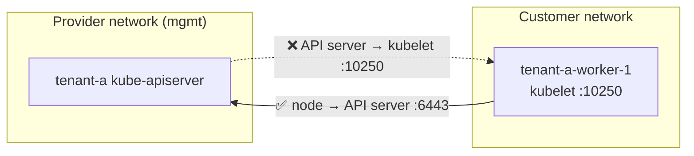

# 8. Simulate a managed Kubernetes network

So far everything lives on the same Docker network, so the control plane can reach the worker node directly. That's not how a managed provider works. The control plane runs in the provider's network, and your nodes run in yours. Nodes can reach the API server through its public endpoint, but the API server can't open connections into your network.



Most of Kubernetes only needs the node → API server direction. A few features need the other one, because the API server has to call the kubelet:

- `kubectl logs`
- `kubectl exec` and `kubectl attach`
- `kubectl port-forward`

Simulate the boundary: block the `mgmt` nodes from reaching the kubelet port (`10250`) on the worker node.
```sh
for n in $(kind get nodes --name mgmt); do
  ip=$(docker inspect -f '{{range .NetworkSettings.Networks}}{{.IPAddress}}{{end}}' "$n")
  docker exec tenant-a-worker-1 iptables -I INPUT -p tcp --dport 10250 -s "$ip" -j DROP
done

docker exec tenant-a-worker-1 iptables -L INPUT -n | grep 10250
```

```{ .text .no-copy title="Output" }
DROP       tcp  --  172.18.0.2           0.0.0.0/0            tcp dpt:10250
DROP       tcp  --  172.18.0.4           0.0.0.0/0            tcp dpt:10250
DROP       tcp  --  172.18.0.3           0.0.0.0/0            tcp dpt:10250
```

- `kind get nodes --name mgmt`: lists the 3 `mgmt` nodes, where the `tenant-a` API server Pods run.
- `docker inspect`: gets each node's IP on the `kind` network.
- `iptables ... -j DROP`: silently drops TCP traffic from that IP to port `10250`.

!!! tip "Why block the `mgmt` node IPs, not the API server Pods?"
    Traffic leaving a Pod for an address outside the cluster is translated to its node's IP. From the worker's point of view, the API server calls come from the `mgmt` nodes.

The boundary is in place. Next, [run a workload](09-workload.md) and see what still works and what doesn't.
