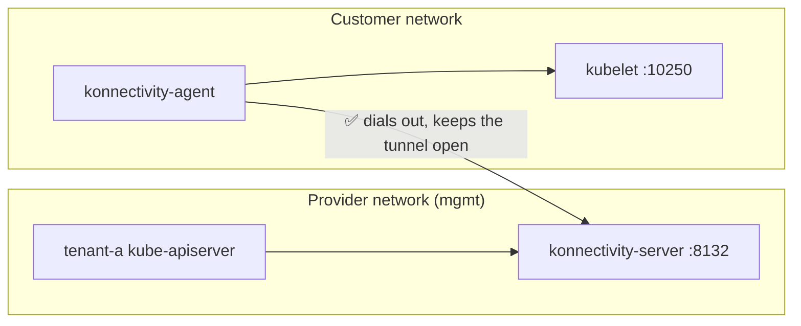

# 10. Fix with Konnectivity

The API server can't reach into the customer network, but the nodes can reach out. So turn the connection around: something on the node dials **out** to the control plane and keeps a tunnel open, and the API server sends its kubelet traffic back through it. That's [Konnectivity](https://kubernetes.io/docs/tasks/extend-kubernetes/setup-konnectivity/), the Kubernetes project for exactly this problem.



- `konnectivity-server`: a new container in the control plane Pods.
- `konnectivity-agent`: runs on the worker nodes and dials out to the server.

Patch the `TenantControlPlane` resource to enable Konnectivity:
```sh
kmgmt -n tenant-a patch tcp tenant-a --type merge -p '{
  "spec": {
    "addons": {
      "konnectivity": {
        "server": {"port": 8132},
        "agent": {"mode": "DaemonSet"}
      }
    }
  }
}'
```

```{ .text .no-copy title="Output" }
tenantcontrolplane.kamaji.clastix.io/tenant-a patched
```

- `server.port: 8132`: the port the `konnectivity-server` listens on.
- `agent.mode: DaemonSet`: run one agent on every worker node.

The `tenant-a` control plane Pods roll. Thanks to the Deployment, the API server stays available during the change:
```sh
kmgmt -n tenant-a get pods
```

```{ .text .no-copy title="Output" }
NAME                        READY   STATUS    RESTARTS   AGE
tenant-a-9787c789c-thdlw    4/4     Running   0          35s
tenant-a-9787c789c-x8wvh    4/4     Running   0          35s
```

They now carry a 4th container:
```sh
kmgmt -n tenant-a get deploy tenant-a \
  -o jsonpath='{range .spec.template.spec.containers[*]}{.name}{"\n"}{end}'
```

```{ .text .no-copy title="Output" }
kube-apiserver
kube-scheduler
kube-controller-manager
konnectivity-server
```

The Service now also exposes port 8132:
```sh
kmgmt -n tenant-a get svc tenant-a
```

```{ .text .no-copy title="Output" }
NAME       TYPE           CLUSTER-IP      EXTERNAL-IP   PORT(S)                         AGE
tenant-a   LoadBalancer   10.96.112.188   172.18.0.5    6443:31564/TCP,8132:31247/TCP   4d14h
```

- `6443`: the API server, as before.
- `8132`: the `konnectivity-server`, where the agents connect.

Kamaji installed the agent inside `tenant-a`. Wait until the tunnel is up:
```sh
kta -n kube-system rollout status ds/konnectivity-agent
```

```{ .text .no-copy title="Output" }
daemon set "konnectivity-agent" successfully rolled out
```

Check where the agent connects to:
```sh
kta -n kube-system get ds konnectivity-agent -o yaml \
  | grep -E -- '--proxy-server'
```

```{ .text .no-copy title="Output" }
        - --proxy-server-host=172.18.0.5
        - --proxy-server-port=8132
```

- `--proxy-server-host`: the load balancer, the same public endpoint the kubelet uses.
- `--proxy-server-port`: the `konnectivity-server` port.

The iptables rules are still there. We didn't open anything; the traffic just flows the other way. Try the logs again:
```sh
kta logs deploy/web --tail 5
```

```{ .text .no-copy title="Output" }
Found 2 pods, using pod/web-795767664d-sl6tx
2026/10/27 13:34:06 [notice] 1#1: start worker process 38
2026/10/27 13:34:06 [notice] 1#1: start worker process 39
[...]
```

And exec:
```sh
kta exec deploy/web -- hostname
```

```{ .text .no-copy title="Output" }
web-795767664d-sl6tx
```

--8<-- "vevox-checkpoint.md"

Logs and exec work again, and the boundary is still there. That's day one done. Next, [upgrade Kubernetes](11-upgrade.md), the way a provider does.
