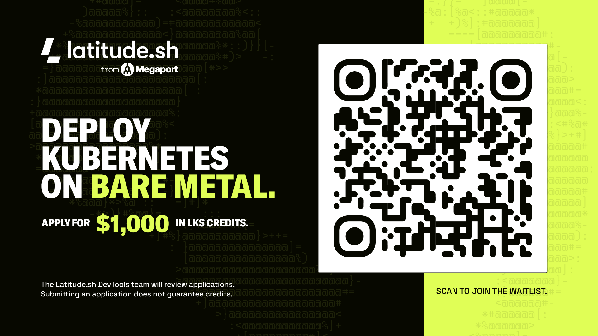
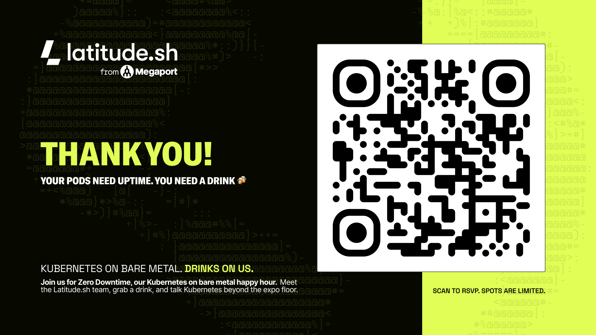

# On the house

./on-the-house

$1,000 in LKS credits, and drinks tonight.

Two things to scan before we start building. Both come back at the end, during the Q&A.

./lks-credits

## Apply for $1,000 in LKS credits

Want to run this on real bare metal? Latitude.sh is giving $1,000 in LKS credits to people who apply. Scan the QR code or open [latitude.sh/lks-wishlist](https://www.latitude.sh/lks-wishlist) to join the waitlist.

The Latitude.sh DevTools team reviews the applications. Submitting an application does not guarantee credits. [Join the waitlist](https://www.latitude.sh/lks-wishlist){ .lat-button }

./happy-hour

## Zero Downtime, the happy hour

Your Pods need uptime. You need a drink. Join us for Zero Downtime, the Latitude.sh Kubernetes on bare metal happy hour: meet the team, grab a drink and talk Kubernetes beyond the expo floor. It's on Tuesday, November 10, from 5 to 8 pm, at Repeal in Salt Lake City. Spots are limited.

Tuesday, November 10, 5 to 8 pm, Repeal, Salt Lake City. [RSVP on Luma](https://luma.com/j906i3rf){ .lat-button }

Next, the [Introduction](index.md) to the workshop.
