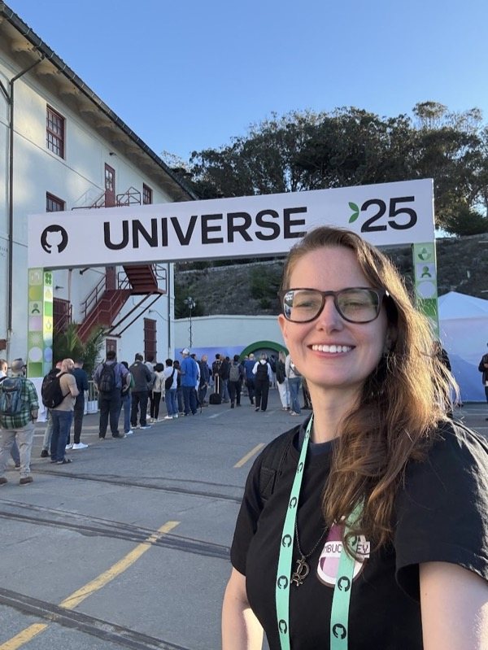
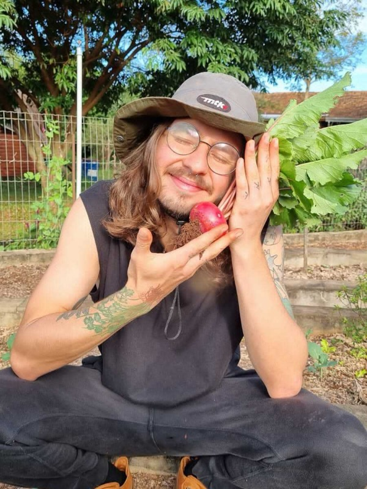

# Your hosts

Two people from Latitude.sh are running this workshop. Grab us at any point, during the steps or after, and if you get stuck, that's what we're here for.

**Camila Maia**

Camila Maia is a Developer Relations Specialist at Latitude.sh, where she helps developers build and scale AI applications on bare metal. She is the creator of [ScanAPI](https://scanapi.dev), an open source API testing framework, and the founder of [Cumbuca Dev](https://cumbuca.dev), an initiative that promotes education via open source. An open source maintainer featured by the Open Source Initiative and GitHub, she is passionate about developer experience and making complex technologies accessible through education and community.

[GitHub](https://github.com/camilamaia) · [LinkedIn](https://www.linkedin.com/in/cmaiacd) · [X](https://x.com/cmaiacd) · [camilamaia.com](https://camilamaia.com)

**Jonatas Baldin (jojo)**

Jonatas Baldin, also known as jojo, is a software and infrastructure engineer with 10+ years of experience across backend (Python, Go), cloud-native platforms and developer-facing products. He is a Senior Platform Engineer at Latitude.sh, developing the Latitude Kubernetes Service (LKS). He is midway through an undergraduate degree in Psychology.

[GitHub](https://github.com/jonatasbaldin) · [LinkedIn](https://www.linkedin.com/in/jonatas-baldin-de-oliveira-5138a02a4/) · [jojo.garden](https://jojo.garden)

Next, [Latitude.sh](latitude.md), the company behind the workshop and the product it takes apart.
