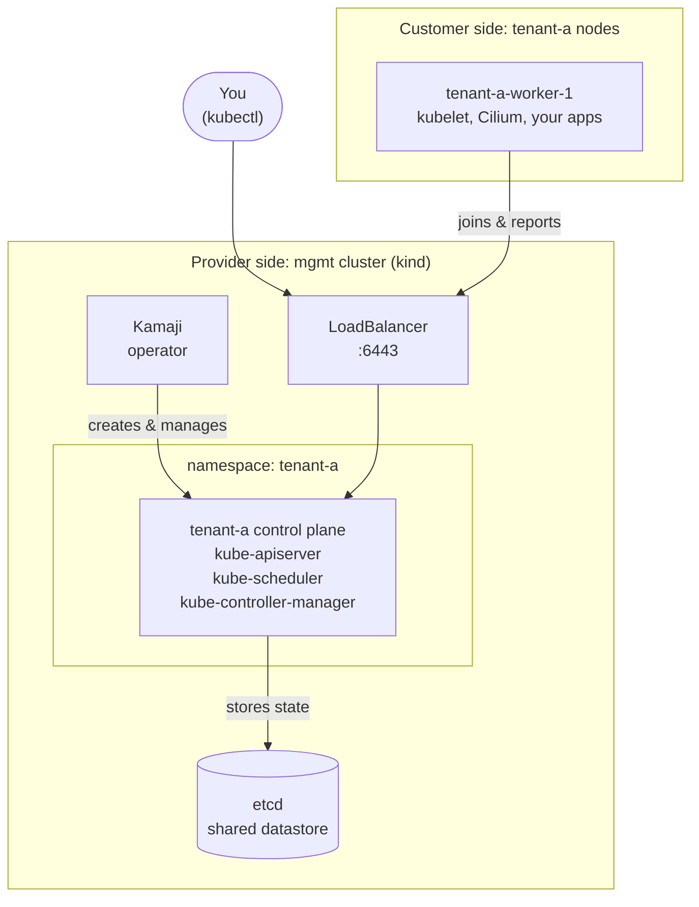

# Managed Kubernetes Workshop

<!-- Same components as docs/latitude.md and docs/lks.md: hero, ./labels,
     stacks, cards. The tool cards carry a badge that says whether the tool
     is a teaching aid for the laptop or something a provider would run. -->

./managed-k8s-workshop

Build your own managed Kubernetes provider, on your laptop.

When you click "Create Cluster" on a managed Kubernetes platform, you get a working API server in a few minutes and never see the control plane. This workshop shows what's behind that button, by making you build it.

./goal

## The goal

In two hours you'll build the pieces a managed Kubernetes provider runs, step by step, and hit the problems they had to solve. You leave knowing:

  
1Where a customer's control plane actually lives, and what "managed" means for it.

  
2Why the provider's network and the customer's network are separate, what that breaks, and how a tunnel fixes it.

  
3How upgrades and add-ons are rolled out from the provider's side, without touching your workloads.

./who-is-this-for

## Who this is for

  

    Platform engineers
    Deciding between building and buying
    Before you run control planes for other teams, see what that actually takes: the boundary, the tunnel, the upgrades, the add-ons. Two hours of it is enough to size the job.
  

  

    SREs and operators
    Running or evaluating a managed Kubernetes
    Know what your provider does for you, what the network boundary breaks, and what an upgrade really changes.
  

  

    Developers
    Curious about the "Create Cluster" button
    You use managed Kubernetes every day and never saw a control plane. Two hours later, you'll have run one.
  

  

    Learning Kubernetes internals
    Past the basics, before the source code
    API server, etcd, kubelet, CNI, the tunnel: see how the pieces fit by wiring them up yourself.
  

You need to be comfortable with `kubectl` and a terminal. You don't need to have run a control plane before. That's the point.

./two-tracks

## Two tracks: the laptop and the real thing

  

    
Steps 1 to 13: the didactic path

    
Everything on your laptop<small>Docker, kind, open source tools, no account</small>

    
A simulated provider<small>a fake fleet, a fake load balancer, a fake network boundary</small>

    
The real problems<small>hosted control planes, the tunnel, upgrades, add-ons</small>

    
This is the workshop. The tools are stand-ins, the problems are the real ones.

  

  

    
Step 14: the real thing on LKS

    
Optional bonus<small>needs a Latitude.sh account</small>

    
An LKS cluster as the management cluster<small>real managed Kubernetes</small>

    
A bare metal server as the worker<small>real infrastructure</small>

    
The same build, on real infrastructure, if you have access and time.

  

!!! warning "The tutorial is not LKS"
    Steps 1 to 13 don't use LKS and don't show how LKS is built. They use open source tools to simulate what any managed Kubernetes provider does, so the shape of the problem is clear. LKS itself only shows up in [step 14](14-lks.md).

./toolbox

## The tools, and why they're here

Some of these are here because they run on a laptop. A provider would never ship them. Others are production-grade and are one way, among several, to solve the problem.

  

    Teaching aid
    kind
    Runs the <code>mgmt</code> cluster as Docker containers. A provider runs a real fleet of servers.
  

  

    Teaching aid
    Docker containers as worker nodes
    Stand-ins for the customer's servers. A provider's node pools are bare metal or VMs.
  

  

    Teaching aid
    cloud-provider-kind
    Gives <code>LoadBalancer</code> Services an IP on your laptop. The real thing is the provider's load balancer.
  

  

    Teaching aid
    An iptables rule
    Drops traffic from the control plane to the nodes, to simulate two networks. A provider has two actual networks.
  

  

    Production-grade
    Kamaji
    Runs customer control planes as Pods. Open source and used in production, but one way to do it, not the way.
  

  

    Production-grade
    Konnectivity
    The upstream Kubernetes tunnel from the control plane to the nodes. This is what providers run.
  

  

    Production-grade
    Cilium
    The CNI. Used in production everywhere, including LKS.
  

  

    Production-grade
    Sveltos
    Installs add-ons in every cluster from the management side. One of several tools that do this.
  

./what-you-build

## What you'll build

There are two kinds of cluster here:

- **The management cluster (`mgmt`)**: run by the provider. Users never see it. It hosts the control planes of every customer cluster.
- **The tenant cluster (`tenant-a`)**: what the customer gets. Its control plane runs as ordinary Pods inside `mgmt`. Its worker nodes run elsewhere, in the "customer's" network.

You'll use one kubeconfig for each, so always check which cluster you're talking to.

./steps

## What we'll do

Fourteen steps in five parts. Every step ends with a checkpoint, so you can tell us how it went.

  

    Setup
    A management cluster on your laptop, with the platform the provider runs: cert-manager, Kamaji and etcd.
    
      <a href="01-prerequisites/"><b>1</b>Prerequisites</a>
      <a href="02-workshop-files/"><b>2</b>Workshop files</a>
      <a href="03-management-cluster/"><b>3</b>kind cluster</a>
      <a href="04-cloud-provider-kind/"><b>4</b>cloud-provider-kind</a>
      <a href="05-helm-packages/"><b>5</b>Helm packages</a>
    
  

  

    Hosted control plane
    A control plane for <code>tenant-a</code> as Pods in <code>mgmt</code>, then a worker node that joins it.
    
      <a href="06-hosted-control-plane/"><b>6</b>Create a control plane</a>
      <a href="07-worker-node/"><b>7</b>Join a worker node</a>
    
  

  

    Provider network
    A boundary between the provider and the customer. Watch <code>kubectl logs</code> and <code>exec</code> break, then fix them with a tunnel.
    
      <a href="08-provider-network/"><b>8</b>Simulate the network</a>
      <a href="09-workload/"><b>9</b>Run a workload</a>
      <a href="10-konnectivity/"><b>10</b>Konnectivity</a>
    
  

  

    Operations
    Upgrade Kubernetes the way a provider does, control plane in place and workers by replacement. Push add-ons from the management side. Clean up.
    
      <a href="11-upgrade/"><b>11</b>Upgrade</a>
      <a href="12-sveltos/"><b>12</b>Sveltos</a>
      <a href="13-clean-up/"><b>13</b>Clean up</a>
    
  

  

    Bonus
    The same build on real infrastructure: an LKS cluster and a bare metal server. Optional.
    
      <a href="14-lks/"><b>14</b>Run it on LKS</a>
    
  

./account

## Latitude.sh account

Not for steps 1 to 13. Everything runs on your laptop in Docker.

[Step 14](14-lks.md) is the bonus round, with real infrastructure: an LKS cluster as the management cluster and a bare metal server as the worker node. For that you need a [Latitude.sh account](https://www.latitude.sh/dashboard/signup), an LKS cluster with 3 worker nodes and an Ubuntu 24.04 server. The step has its own clean-up section, so you can delete both when you're done.

Ready? Start with [1. Prerequisites](01-prerequisites.md).
