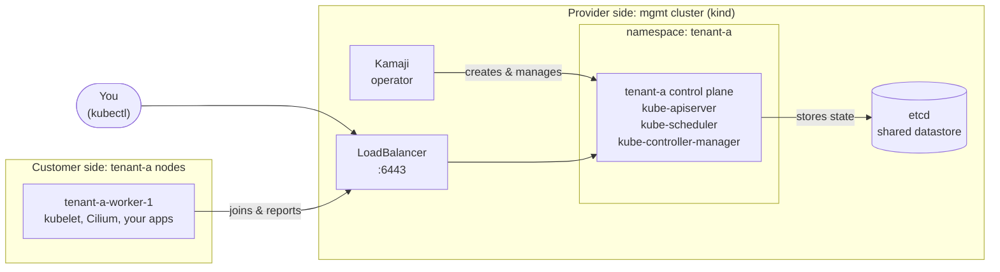

# Managed Kubernetes Workshop

**Build your own managed Kubernetes provider, on your laptop.**

When you click "Create Cluster" on a managed Kubernetes platform, like [LKS](https://www.latitude.sh/docs/lks), you get a working API server in a few minutes, but you never see the control plane. There are no control plane nodes to SSH into and no etcd to back up. You add worker nodes and they just join.

This workshop shows what's behind that button. You'll build the same pieces a provider might run, step by step, and hit the same problems they had to solve.

!!! tip "New to Latitude.sh?"
    Read [What is Latitude.sh?](latitude.md) first. It explains the company, what LKS is, and how each piece of LKS maps to a step of this workshop.

## What you'll build

There are two kinds of cluster here:

- **The management cluster (`mgmt`)**: run by the provider. Users never see it. It hosts the control planes of every customer cluster.
- **The tenant cluster (`tenant-a`)**: what the customer gets. Its control plane runs as ordinary Pods inside `mgmt`. Its worker nodes run elsewhere, in the "customer's" network.

You'll use one kubeconfig for each, so always check which cluster you're talking to.

## How this maps to the real world

| In this workshop | At a managed provider |
|---|---|
| `mgmt` kind cluster | The provider's internal fleet that runs customer control planes |
| Kamaji `TenantControlPlane` | The "cluster" you create in the console or API |
| `tenant-a-worker-*` Docker containers | Your node pools (VMs or bare metal) |
| `cloud-provider-kind` | The cloud load balancer in front of your API server |
| Konnectivity | The tunnel the control plane uses to reach your nodes |
| Sveltos `ClusterProfile` | The add-ons the provider installs in every cluster (CNI, CSI, metrics) |

## What we'll do

- [Create the management cluster](03-management-cluster.md) and [install the platform](05-helm-packages.md): cert-manager, Kamaji and etcd.
- [Create a hosted control plane](06-hosted-control-plane.md) for `tenant-a` and look at what's inside it.
- [Join a worker node](07-worker-node.md) and install a CNI.
- [Simulate a real provider network](08-provider-network.md) and [watch `kubectl logs` and `kubectl exec` break](09-workload.md).
- [Fix them with Konnectivity](10-konnectivity.md).
- [Upgrade Kubernetes](11-upgrade.md) the way providers do: control plane in place, workers by replacement.
- [Manage add-ons with Sveltos](12-sveltos.md): install the CNI from the management cluster, the way providers do.
- [Bonus: run it on LKS](14-lks.md), with real infrastructure.
