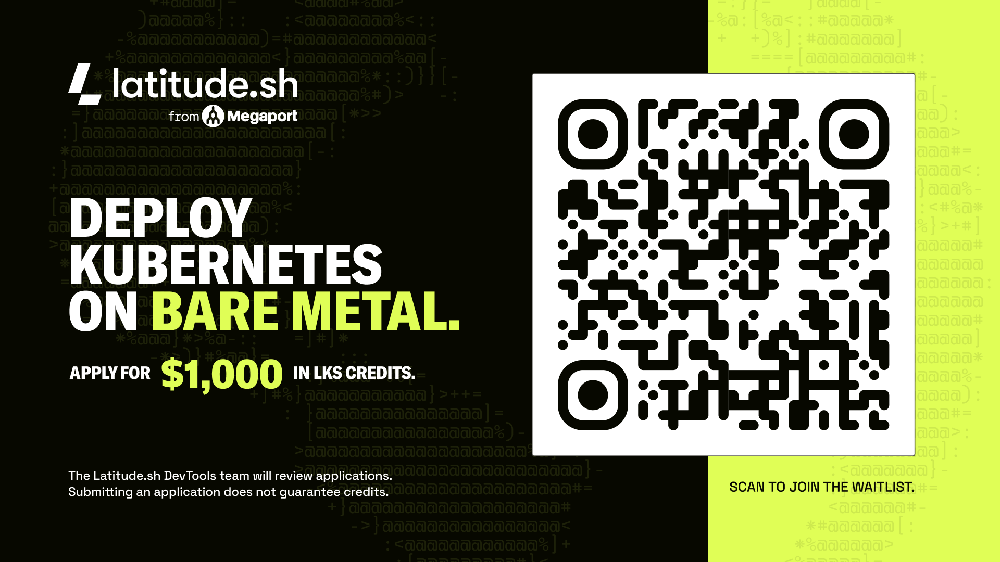
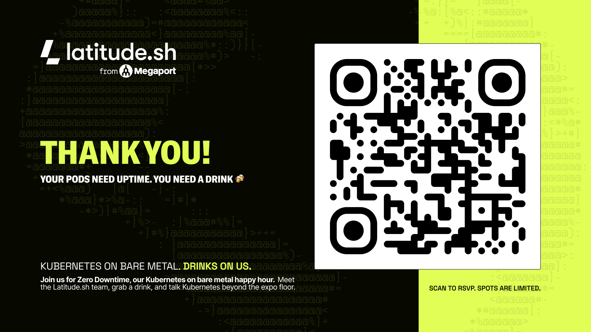

# Wrap-up

You started with a "Create Cluster" button and ended with everything behind it running on your laptop:

- A management cluster that hosts a customer control plane as ordinary Pods, with Kamaji and a shared etcd.
- A worker node in another network that joined through a load balancer and never saw the control plane.
- The boundary between the provider's network and the customer's, the features it breaks, and Konnectivity as the fix.
- An upgrade the way providers do it: control plane in place, workers by replacement.
- Add-ons installed from the provider side with Sveltos.

Those are the pieces every managed Kubernetes provider has to build, [LKS](latitude.md#lks-the-managed-kubernetes) included.

## Apply for $1,000 in LKS credits

Want to run this on real bare metal? Latitude.sh is giving $1,000 in LKS credits to people who apply. Scan the QR code or open [latitude.sh/lks-wishlist](https://www.latitude.sh/lks-wishlist) to join the waitlist.

The Latitude.sh DevTools team reviews the applications. Submitting an application does not guarantee credits.

## Keep going

- [Run the workshop on LKS](14-lks.md), with an LKS cluster as the management cluster and a bare metal server as the worker node.
- Read the [LKS docs](https://www.latitude.sh/docs/lks) to see how the managed version handles networking, storage and upgrades.
- Go deeper into the tools: [Kamaji](https://kamaji.clastix.io/), [Sveltos](https://projectsveltos.github.io/sveltos/) and [Konnectivity](https://kubernetes.io/docs/tasks/extend-kubernetes/setup-konnectivity/).
- Found a problem or have an idea? [Open an issue](https://github.com/latitudesh/managed-k8s-workshop/issues) in the workshop repository.

## Thank you

Your Pods need uptime. You need a drink. Join us for Zero Downtime, the Latitude.sh Kubernetes on bare metal happy hour: meet the team, grab a drink and talk Kubernetes beyond the expo floor. It's on Tuesday, November 10, from 5 to 8 pm, at Repeal in Salt Lake City. Scan the QR code or [RSVP on Luma](https://luma.com/j906i3rf). Spots are limited.

